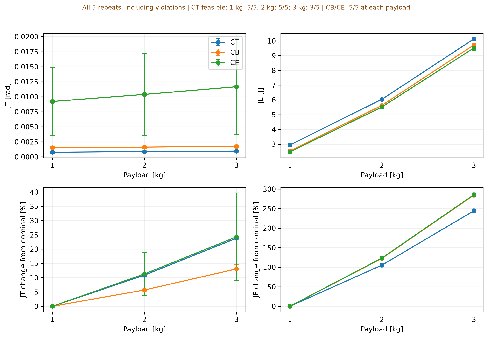

# Payload MOBO

**Payload 변화에 따른 1자유도 관절의 추종–에너지 상충 관계와 PID 전이**

Maxon RE35 323890 + GP42C를 참고한 감속기 구동 관절 시뮬레이션입니다. PID gain을 제약부 qLogNEHVI로 탐색해 tracking RMSE와 부호 있는 모터 단자 에너지를 동시에 최소화합니다.

## 먼저 보기

| 자료 | 내용 |
|---|---|
| [논문 초안](paper/KRoC_Payload_MOBO_4p.docx) | 사용자가 제공한 최신 4페이지 형식 원고, 원본 내용 유지 |
| [교수님 설명용 정리](docs/PROFESSOR_BRIEF.md) | 연구 질문 → 모델 → 시뮬레이션 → 최적화 → 두 실험 → 결과·한계 |
| [본실험 결과](reports/canonical-final/REPORT.md) | 80회 후보 × 5반복, payload 1/2/3 kg |
| [80→160회 보조 진단](reports/heavy-diagnostics-20261001/REPORT.md) | Heavy payload 예산 민감성 및 원자료 감사 |
| [추가 gain-bound pilot](pilot/diagnostic-20261023/README.md) | 논문 본실험과 구분한 10월 23일 진단 |
| [물리 모델](docs/CANONICAL_MODEL.md) · [설정](configs/canonical_final.toml) | 수치·단위·가정·파라미터 출처 상태 |

## 주요 결과

| Payload | 최소 JT 평균 [mrad] | JT≤0.01 rad 아래 최소 JE 평균 [J] |
|---|---:|---:|
| 1 kg | 0.7804 | 2.4782 |
| 2 kg | 0.9880 | 5.5534 |
| 3 kg | 3.0500 | 9.5923 |

위 값은 선택 seed에서 얻은 5회 평균입니다. 정확히 같은 JT에서 보간한 값이 아니라 공통 허용오차 아래의 관측 최소값입니다.

Nominal 1 kg에서 고른 CT·CB·CE를 재튜닝 없이 전이했을 때, **CT는 3 kg에서 작은 추종 오차를 유지했지만 전류 기준은 3/5만 통과**했습니다. CB·CE는 모든 payload에서 5/5 통과했습니다. 따라서 추종 성능만으로 제어기 전이의 실행 가능성을 판단할 수 없습니다.



## 실험 조건

- 5초 quintic 이동, 0→π/3 rad, 목표각 유지 구간 없음.
- 1 ms 센서·PID 갱신, RK4 16 substeps, 센서 잡음 분산 10⁻⁷ rad².
- Gain 범위 [0,800] / [0,400] / [0,80], 후보 80개에 Zero-PID와 Sobol 초기 10개 포함.
- 학습 3개 / 선택 5개 / 시험 10개 잡음 seed 분리, payload별 독립 최적화 5회.
- 전류 3.84 A, 위치 π rad, 속도 15 rad/s를 sampled peak feasibility 기준으로 사용. 전류 clipping 없음.
- 대표 선정은 JT≤0.05 rad의 nominal feasible 집합에서 Zero-PID를 제외. 전체 Pareto 집합은 유지.

JE는 signed motor-terminal net energy이며 배터리 총소비량이 아닙니다. 3.84 A는 연속전류 참고값을 peak 판정에 사용한 연구상 가정입니다. 실제 하드웨어 안전성과 전역 최적성은 주장하지 않습니다. Kd=0의 원인도 아직 확인된 결론이 아닙니다.

## 실행 및 검증

Python 3.13 환경과 기록된 의존성으로 실행한 연구입니다. 새 결과는 반드시 새 출력 경로를 사용합니다.

```bash
python -m venv .venv
source .venv/bin/activate
python -m pip install -r requirements-lock.txt
python -m pip install -e '.[dev]'
pytest -q
ruff check src tests experiments analysis

# 간단한 실행 확인: 연구 수치로 사용하지 않음
kroc-mobo all --config configs/canonical_final.toml --out results/new-smoke --smoke

# 본실험 재실행: 새 경로, 총 1,200개 후보 + 선택·시험 비용
kroc-mobo all --config configs/canonical_final.toml --out results/new-main
```

실험 1은 payload별 독립 최적화이고 실험 2는 nominal 집합·대표 gain을 고정한 전이입니다. `all`의 기본 plot과 논문용 요약표 생성기는 구분합니다. 논문 표 재생성에는 저장된 원자료와 아래 문서를 참고하세요.

- [본실험 프로토콜](docs/BUDGET80_PROTOCOL.md)
- [보조 진단 프로토콜](docs/HEAVY_DIAGNOSTIC_PROTOCOL.md)
- [정리·원자료·이전 보고서 복구](docs/REPOSITORY_GUIDE.md)

## 저장소 구조

```text
paper/       제공된 논문 원본
src/         plant, PID, RK4, 목적함수, MOBO, 실험 파이프라인
configs/     최종 설정 및 회귀 테스트용 설정
experiments/ 실행 진입점
analysis/    표·그림 생성과 원자료 감사
reports/     본실험 및 heavy-payload 진단 결과·원자료 ZIP
pilot/       본실험에 섞지 않은 추가 진단
 docs/       모델, 프로토콜, 설명본, 재현·보존 안내
 tests/      수치·선택·제약·최적화 검증
```

`illustrative.toml`은 회귀 테스트용이며 최종 모델이 아닙니다. 과거 보고서 중복본은 `archive/pre-final-20261107` 태그로 보존하고 main에서는 제거했습니다. 제공 원고는 저자·소속 placeholder가 남은 검토 초안이며 제출 완료본을 의미하지 않습니다.
