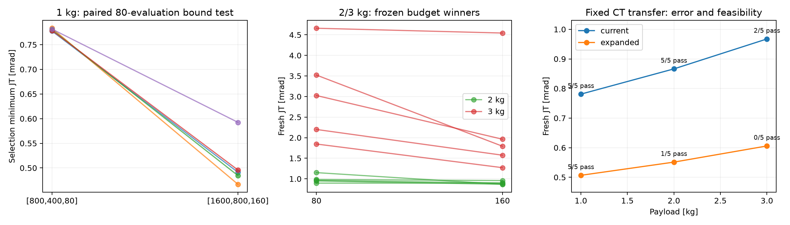

# 추가 gain bound와 예산 진단

이 디렉터리는 논문 본실험과 분리한 2026년 10월 23일 pilot이다.

- [사전 프로토콜](PROTOCOL.md), [상세 결과](REPORT.md)
- [전체 재현 자료 ZIP](reproducibility.zip): 소스·설정·CSV·로그·입력 원자료 포함. 압축 내 원래 폴더 구조를 유지해 사용한다.
- 동일 80회×5반복에서 상한을 [1600,800,160]으로 확장하면 nominal 최소 JT 평균이 35.14% 감소했다.
- 확장 CT의 새 시험은 2 kg 1/5, 3 kg 0/5 feasible이었다. 오차 개선과 전류 제약을 함께 해석해야 한다.
- 기존 80→160회 원자료 감사 및 새 seed 평가를 수행했다. 160회 최적화를 새로 반복했다고 주장하지 않는다.

REPORT.md와 프로토콜의 로컬 경로·원격 미게시 표기는 당시 실행 기록이다. 11월 7일 이 자료를 main에 정리했다. 보고서 안의 옛 Google Docs 불일치 지적은 그 문서에만 해당하며, 이번 제공된 최신 논문에 적용하지 않는다.

