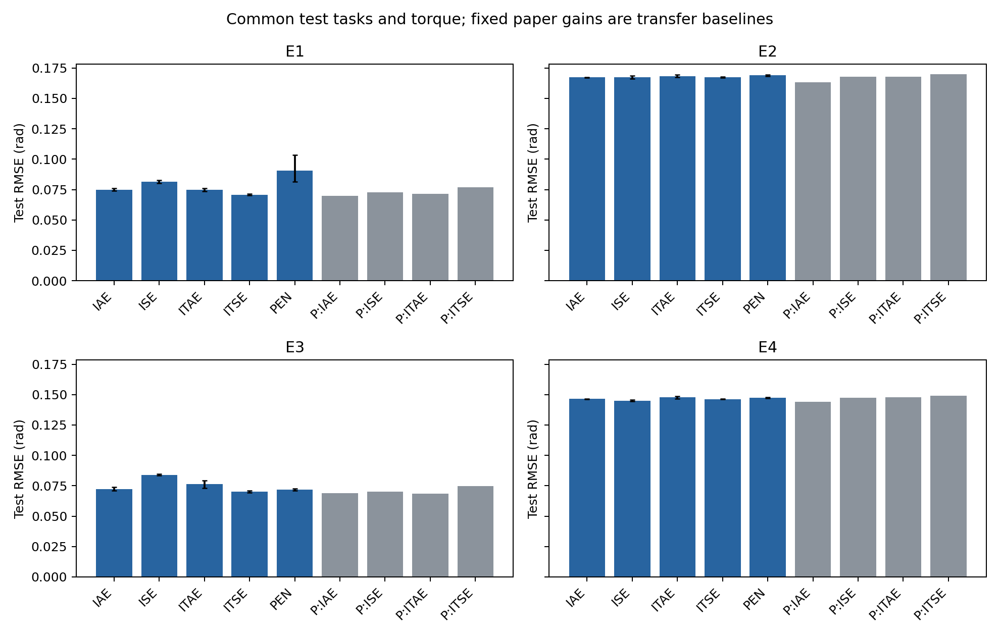
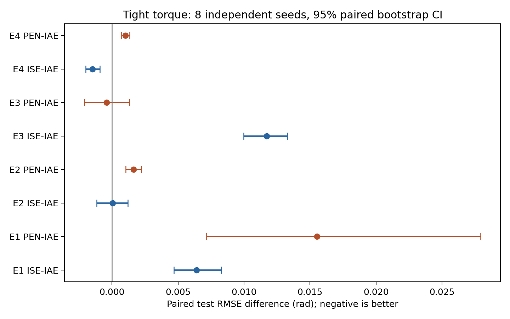
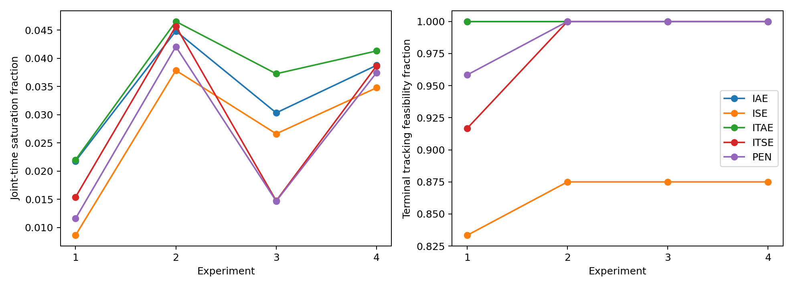
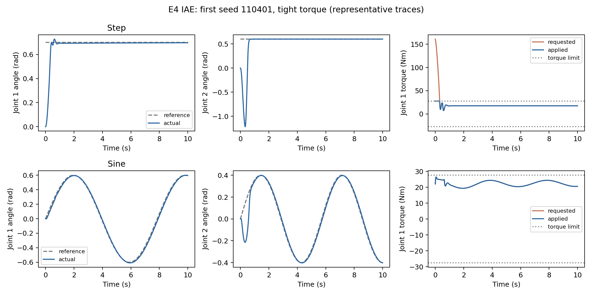

# KRoC 신규 4회 실험 및 원문 비교 보고서

2026-11-11 KST. **판정: 조건부 수치 현상 확인, 새로운 제어·최적화 기법의 우월성 및 학생논문 제출 적합성은 미확보.** 네 실험은 모두 새 seed로 실제 실행했다. 이전 오늘 1–5차 결과를 신규 횟수에 포함하지 않았다. 원격 게시 상태는 `PUBLICATION_STATUS.json`을 기준으로 확인한다.

제한 토크에서 ISE−IAE의 방향은 모델과 질량오차 조건에 따라 바뀌었다. E1과 E3에서는 ISE의 평균 RMSE가 더 높았고, E4에서는 더 낮았다. E2의 차이는 작았고 95% CI가 0을 포함했다. PEN은 네 실험의 평균 포화율을 모두 줄였으나 E1·E2·E4의 평균 RMSE를 높였다. E3에서는 RMSE 차이의 95% CI가 0을 포함했다. 아래 구간은 탐색적이며 다중 비교 보정 후 5% 기준에서 확정한 우위는 없다.

## 완료 범위와 미해결 범위

main과 연구 브랜치 6개, PR #1–#3, 기존 ZIP 28개, Git 추적 이력, Actions 실행 20개의 첨부 목록을 감사했다. Main 산출물 110개와 기존 PR의 해시 130/47/43개가 일치했고, 후보 CSV는 각각 384/88,064/24,576행이었다. 오늘 2–5차 ZIP·보고서는 저장소에서 발견되지 않아 해당 원자료 감사는 미완료다. 회수한 대화 본문은 주장 기록이며 CSV의 대체물이 아니다. 자세한 근거는 [AUDIT_KO.md](AUDIT_KO.md)에 있다.

main의 학생논문은 1DOF 전압 PID의 추종·전기에너지 MOBO 연구이며, 이번 2DOF 토크 PID 실험과 다르다. Canonical 모델, 기존 결과, main은 보존했다. 이번 결과를 main의 전류 제약이나 부호 있는 전기에너지에 대한 직접 검증으로 해석하지 않는다.

## 실제 신규 실행량

| 실험 | 모델 | 실제_m2 | 보상_m2 | 독립_seed수 | 최적화 | 후보 | 학습_rollout | 시험_rollout | 정밀화 | 실행초 |
|---|---|---|---|---|---|---|---|---|---|---|
| E1 | 집중질량 | 5 | 5 | 8 | 40 | 10240 | 20480 | 264 | 240 | 304.147 |
| E2 | 집중질량 | 6 | 5 | 8 | 40 | 10240 | 20480 | 264 | 240 | 298.582 |
| E3 | 균일강체 | 5 | 5 | 8 | 40 | 10240 | 20480 | 264 | 240 | 298.507 |
| E4 | 균일강체 | 6 | 5 | 8 | 40 | 10240 | 20480 | 264 | 240 | 299.868 |

합계 **새 GA 최적화 160회, 후보 40,960개, 학습 시뮬레이션 81,920회, 공통 시험 1,056회, 고정 제어주기의 적분 정밀화 960회**다. 시험은 새 제어기 960회와 원문 고정 gain 96회로 구성된다. 정밀화와 통계 재분석을 별도 신규 실험으로 세지 않는다. 대표 시계열은 해당 시험 실행에서 함께 저장했다. 독립 적분기를 이용한 모델 검증은 이 합계 밖이다.

각 실험의 새 seed 8개는 E1=110101–110108, E2=110201–110208, E3=110301–110308, E4=110401–110408이다. 서로 겹치지 않고 확보한 기존 PR의 seed와도 겹치지 않는다. 미확보 ZIP 전체와의 중복 여부까지 검증한 것은 아니다.

## 고정한 조건과 비교의 의미

E1/E2는 끝점 집중질량, E3/E4는 균일 강체 링크이며 질량분포와 관성식이 다르다. 두 상용 로봇을 검증한 것은 아니다. E2/E4의 실제 m2=6kg와 보상 모델 m2=5kg가 20% 불일치하며, 실제 질량은 M,C,G 전체에 적용했다. **튜닝은 각 실제 plant의 응답을 평가하므로, 미지의 확률적 로봇 모집단이나 새 질량으로의 무튜닝 전이에 대한 강인성 증거는 아니다.**

IAE/ISE/ITAE/ITSE/PEN 모두 같은 GA, gain 범위, 초기 모집단을 사용했고 256후보×2학습궤적=512호출을 배정했다. PEN은 선행논문의 포화·노력 벌점 설계를 이식한 비교군이며 새 알고리즘이 아니다. Overshoot 벌점은 step 학습에만 적용하고 quintic에서는 0으로 처리한다. 시험 결과로 gain을 선택하지 않았다. 모든 방법과 원문 고정 gain에 같은 새 step·빠른 quintic·sine 시험 3개와 토크 한계 2종을 적용했다. 자세한 조건은 실행 전 [프로토콜](PROTOCOL_KO.md)에 있다.

제한 토크는 nominal 중력 전역 상한의 1.25배, 일반 토크는 2배이며 실물 정격이 아니다. Feedforward를 포함한 전체 명령에 clipping을 적용했다. Nominal 중력 보상, PI-D와 conditional anti-windup, 제어주기 2ms와 RK4 내부 간격 1ms를 사용한다. 센서 잡음·지연·마찰·모터 전기회로·열·기어는 포함하지 않았다.

## 동일 시험 지표의 결과

아래는 제한 토크에서 시험 3개의 평균이다. 단위는 RMSE(rad), IAE(rad·s), 적용 토크 RMS(Nm)다. 포화율은 관절×시간 비율이며, 추종 조건 만족률은 마지막 샘플의 두 오차≤.02rad와 수치 성공을 뜻한다. 전구간 안전성이나 Lyapunov 안정성의 증명이 아니다.

| experiment | method | rmse | iae | torque_rms | saturation_duty | tracking_feasible |
|---|---|---|---|---|---|---|
| 1 | IAE | 0.0749412 | 0.351764 | 16.9716 | 0.0217833 | 1 |
| 1 | ISE | 0.0813483 | 0.560457 | 16.8568 | 0.008625 | 0.833333 |
| 1 | ITAE | 0.0746905 | 0.348402 | 16.979 | 0.0220083 | 1 |
| 1 | ITSE | 0.0707671 | 0.41717 | 16.9024 | 0.0153958 | 0.916667 |
| 1 | PAPER_IAE | 0.0698671 | 0.416961 | 16.7929 | 0.0163667 | 0.666667 |
| 1 | PAPER_ISE | 0.0726119 | 0.383389 | 16.9036 | 0.0199667 | 1 |
| 1 | PAPER_ITAE | 0.0713114 | 0.405924 | 16.8576 | 0.0169667 | 0.666667 |
| 1 | PAPER_ITSE | 0.0770439 | 0.402375 | 16.9117 | 0.0205667 | 1 |
| 1 | PEN | 0.090465 | 0.614766 | 17.0492 | 0.0115958 | 0.958333 |
| 2 | IAE | 0.167352 | 0.733076 | 18.3658 | 0.0448542 | 1 |
| 2 | ISE | 0.167395 | 1.00933 | 18.5808 | 0.0378708 | 0.875 |
| 2 | ITAE | 0.168115 | 0.731018 | 18.4085 | 0.0465417 | 1 |
| 2 | ITSE | 0.167307 | 0.746958 | 18.3865 | 0.0457 | 1 |
| 2 | PAPER_IAE | 0.163289 | 0.835876 | 18.2259 | 0.0410333 | 0.666667 |
| 2 | PAPER_ISE | 0.167795 | 0.770543 | 18.2959 | 0.0425333 | 1 |
| 2 | PAPER_ITAE | 0.167939 | 0.819223 | 18.2534 | 0.0415 | 0.666667 |
| 2 | PAPER_ITSE | 0.169882 | 0.78355 | 18.3043 | 0.0426333 | 1 |
| 2 | PEN | 0.168982 | 0.822574 | 18.3584 | 0.0420792 | 1 |
| 3 | IAE | 0.0722655 | 0.305107 | 10.9772 | 0.0303458 | 1 |
| 3 | ISE | 0.0839816 | 0.588876 | 10.9453 | 0.0266292 | 0.875 |
| 3 | ITAE | 0.0763727 | 0.320069 | 10.9927 | 0.037275 | 1 |
| 3 | ITSE | 0.0701682 | 0.378725 | 10.9707 | 0.0147542 | 1 |
| 3 | PAPER_IAE | 0.0688404 | 0.3913 | 10.8628 | 0.0131667 | 0.666667 |
| 3 | PAPER_ISE | 0.0702338 | 0.38032 | 11.0599 | 0.232367 | 1 |
| 3 | PAPER_ITAE | 0.068627 | 0.374215 | 10.8839 | 0.0138667 | 0.666667 |
| 3 | PAPER_ITSE | 0.0748339 | 0.405364 | 11.0679 | 0.232967 | 1 |
| 3 | PEN | 0.0718683 | 0.376736 | 10.9427 | 0.0146958 | 1 |
| 4 | IAE | 0.146527 | 0.625991 | 12.2071 | 0.0387708 | 1 |
| 4 | ISE | 0.145055 | 0.750403 | 12.1973 | 0.0347875 | 0.875 |
| 4 | ITAE | 0.147707 | 0.600774 | 12.2287 | 0.0413208 | 1 |
| 4 | ITSE | 0.146315 | 0.624365 | 12.2016 | 0.038675 | 1 |
| 4 | PAPER_IAE | 0.144161 | 0.707904 | 12.1071 | 0.0366 | 0.666667 |
| 4 | PAPER_ISE | 0.147384 | 0.660137 | 12.271 | 0.2762 | 1 |
| 4 | PAPER_ITAE | 0.147809 | 0.692337 | 12.1253 | 0.0371 | 0.666667 |
| 4 | PAPER_ITSE | 0.148956 | 0.674277 | 12.2405 | 0.2005 | 1 |
| 4 | PEN | 0.147539 | 0.64795 | 12.1809 | 0.0374708 | 1 |

고정 원문 gain은 PAPER_ 접두어로 구분했다. 같은 제어 구조와 모델에 이식한 배포 기준이며, 원문 방법 전체의 재현이 아니다. 고정 gain의 시험은 결정적이므로 동일 결과를 8번 복제해 신뢰구간을 만들지 않는다.

### RMSE의95% 신뢰구간

| experiment | method | mean | ci_low | ci_high |
|---|---|---|---|---|
| 1 | IAE | 0.0749412 | 0.0737828 | 0.0762129 |
| 1 | ISE | 0.0813483 | 0.0803648 | 0.0825808 |
| 1 | ITAE | 0.0746905 | 0.0733869 | 0.0758911 |
| 1 | ITSE | 0.0707671 | 0.0702114 | 0.0712804 |
| 1 | PEN | 0.090465 | 0.0815347 | 0.103487 |
| 1 | PAPER_IAE | 0.0698671 | NA | NA |
| 1 | PAPER_ISE | 0.0726119 | NA | NA |
| 1 | PAPER_ITAE | 0.0713114 | NA | NA |
| 1 | PAPER_ITSE | 0.0770439 | NA | NA |
| 2 | IAE | 0.167352 | 0.167133 | 0.167582 |
| 2 | ISE | 0.167395 | 0.166103 | 0.168627 |
| 2 | ITAE | 0.168115 | 0.167355 | 0.169315 |
| 2 | ITSE | 0.167307 | 0.167013 | 0.167683 |
| 2 | PEN | 0.168982 | 0.168343 | 0.169584 |
| 2 | PAPER_IAE | 0.163289 | NA | NA |
| 2 | PAPER_ISE | 0.167795 | NA | NA |
| 2 | PAPER_ITAE | 0.167939 | NA | NA |
| 2 | PAPER_ITSE | 0.169882 | NA | NA |
| 3 | IAE | 0.0722655 | 0.0708017 | 0.0739286 |
| 3 | ISE | 0.0839816 | 0.0833749 | 0.0845805 |
| 3 | ITAE | 0.0763727 | 0.0732278 | 0.0792446 |
| 3 | ITSE | 0.0701682 | 0.0694433 | 0.0709509 |
| 3 | PEN | 0.0718683 | 0.0708705 | 0.0727897 |
| 3 | PAPER_IAE | 0.0688404 | NA | NA |
| 3 | PAPER_ISE | 0.0702338 | NA | NA |
| 3 | PAPER_ITAE | 0.068627 | NA | NA |
| 3 | PAPER_ITSE | 0.0748339 | NA | NA |
| 4 | IAE | 0.146527 | 0.146298 | 0.146733 |
| 4 | ISE | 0.145055 | 0.144634 | 0.145538 |
| 4 | ITAE | 0.147707 | 0.146746 | 0.148831 |
| 4 | ITSE | 0.146315 | 0.146186 | 0.146457 |
| 4 | PEN | 0.147539 | 0.147071 | 0.14799 |
| 4 | PAPER_IAE | 0.144161 | NA | NA |
| 4 | PAPER_ISE | 0.147384 | NA | NA |
| 4 | PAPER_ITAE | 0.147809 | NA | NA |
| 4 | PAPER_ITSE | 0.148956 | NA | NA |

단위는 rad다. 각 seed 안에서 시험 3개를 먼저 평균한 뒤 독립 최적화 seed 8개를 bootstrap 20,000회 재표집했다. 이는 seed 간 튜닝 변동이며 궤적 3개를 독립 반복으로 세지 않는다. 모든 지표·궤적·일반 토크 조건의 CI는 `results/metric_summary.csv`에 저장했다. CI는 다중 보정하지 않은 기술적 구간이다.

## 사전고정8개 primary 대비와 부정적 결과

차이는 해당 방법−IAE이며, 음수면 RMSE가 감소했다. Exact sign-flip의 대칭성 가정과 작은 n을 전제로 사전 고정한 8개 primary p에 Holm 보정을 적용했다. **이 설계의 검정력 한계가 있다. n=8의 양측 exact p 최솟값은 2/256=.0078125이며, Holm 첫 단계는 최소 .0625가 되어 5% familywise 기각이 불가능하다.** 따라서 이 연구는 탐색적 CI와 효과 크기 보고이며, 유의하지 않다는 이유로 동등성이나 효과 부재를 주장하지 않는다. 결과를 본 뒤 표본 수나 primary family를 변경하지 않았다.

| experiment | contrast | mean | ci_low | ci_high | negative_seeds | sign_flip_p | holm_primary_p |
|---|---|---|---|---|---|---|---|
| 1 | ISE-IAE | 0.00640707 | 0.00469927 | 0.00829578 | 0 | 0.0078125 | 0.0625 |
| 1 | PEN-IAE | 0.0155238 | 0.00716228 | 0.0279181 | 0 | 0.0078125 | 0.0625 |
| 2 | ISE-IAE | 4.27072e-05 | -0.00116244 | 0.00119441 | 3 | 0.921875 | 1 |
| 2 | PEN-IAE | 0.00162981 | 0.00105296 | 0.00223033 | 0 | 0.0078125 | 0.0625 |
| 3 | ISE-IAE | 0.011716 | 0.00996284 | 0.0132678 | 0 | 0.0078125 | 0.0625 |
| 3 | PEN-IAE | -0.000397262 | -0.0020877 | 0.0013162 | 4 | 0.671875 | 1 |
| 4 | ISE-IAE | -0.00147181 | -0.00198837 | -0.000924592 | 8 | 0.0078125 | 0.0625 |
| 4 | PEN-IAE | 0.00101161 | 0.000724421 | 0.00132477 | 0 | 0.0078125 | 0.0625 |

- E1 ISE-IAE: +0.006407rad [+0.004699,+0.008296], 평균 RMSE 증가, 95% CI는0제외; Holm p=0.0625.
- E1 PEN-IAE: +0.015524rad [+0.007162,+0.027918], 평균 RMSE 증가, 95% CI는0제외; Holm p=0.0625.
- E2 ISE-IAE: +0.000043rad [-0.001162,+0.001194], 평균 RMSE 증가, 95% CI에0포함; Holm p=1.
- E2 PEN-IAE: +0.001630rad [+0.001053,+0.002230], 평균 RMSE 증가, 95% CI는0제외; Holm p=0.0625.
- E3 ISE-IAE: +0.011716rad [+0.009963,+0.013268], 평균 RMSE 증가, 95% CI는0제외; Holm p=0.0625.
- E3 PEN-IAE: -0.000397rad [-0.002088,+0.001316], 평균 RMSE 감소, 95% CI에0포함; Holm p=1.
- E4 ISE-IAE: -0.001472rad [-0.001988,-0.000925], 평균 RMSE 감소, 95% CI는0제외; Holm p=0.0625.
- E4 PEN-IAE: +0.001012rad [+0.000724,+0.001325], 평균 RMSE 증가, 95% CI는0제외; Holm p=0.0625.

PEN이 포화를 줄여도 추종 성능이 개선됐다는 뜻은 아니다. 사후에 우승 목적함수 하나를 골라 모든 환경에서 우수하다고 제시하지 않는다. CI가 0을 포함하면 우월성을 확정할 수 없고, 0을 제외해도 이 모델·예산·제어 구조 밖으로 일반화할 수 없다. 네 실험은 서로 다른 seed를 쓰므로 E1–E2나 E3–E4를 paired로 차분하지 않았다. Primary 대비는 각 실험 안의 방법 차이이며, 질량오차의 인과 상호작용 검정이 아니다.

### 선행논문 고정 gain과의 직접 공통시험 비교

차이는 새 튜닝 평균−고정 원문 gain이다. 원문 표의 숫자를 그대로 나눈 값이 아니다. fixed_value는 이 benchmark에서 원문 gain의 RMSE다. 차이의 CI는 새 튜닝 seed 8개를 기준으로 한 추가 탐색 비교다.

| experiment | contrast | fixed_value | mean | ci_low | ci_high |
|---|---|---|---|---|---|
| 1 | IAE-PAPER_IAE | 0.0698671 | 0.0050741 | 0.00391366 | 0.0063474 |
| 1 | ISE-PAPER_ISE | 0.0726119 | 0.00873641 | 0.0077529 | 0.00997162 |
| 1 | ITAE-PAPER_ITAE | 0.0713114 | 0.00337912 | 0.00213392 | 0.00458737 |
| 1 | ITSE-PAPER_ITSE | 0.0770439 | -0.00627682 | -0.00682518 | -0.00576071 |
| 1 | PEN-PAPER_IAE | 0.0698671 | 0.0205979 | 0.0116145 | 0.0332453 |
| 2 | IAE-PAPER_IAE | 0.163289 | 0.00406326 | 0.0038417 | 0.0042943 |
| 2 | ISE-PAPER_ISE | 0.167795 | -0.00040079 | -0.00169811 | 0.000818209 |
| 2 | ITAE-PAPER_ITAE | 0.167939 | 0.000175696 | -0.000583957 | 0.00137538 |
| 2 | ITSE-PAPER_ITSE | 0.169882 | -0.00257572 | -0.00286876 | -0.0021929 |
| 2 | PEN-PAPER_IAE | 0.163289 | 0.00569306 | 0.00504635 | 0.00629973 |
| 3 | IAE-PAPER_IAE | 0.0688404 | 0.00342514 | 0.00198364 | 0.00510873 |
| 3 | ISE-PAPER_ISE | 0.0702338 | 0.0137477 | 0.0131529 | 0.0143578 |
| 3 | ITAE-PAPER_ITAE | 0.068627 | 0.00774571 | 0.00457599 | 0.0106176 |
| 3 | ITSE-PAPER_ITSE | 0.0748339 | -0.00466565 | -0.00539408 | -0.00388301 |
| 3 | PEN-PAPER_IAE | 0.0688404 | 0.00302788 | 0.0020655 | 0.00395266 |
| 4 | IAE-PAPER_IAE | 0.144161 | 0.00236547 | 0.00213679 | 0.00257072 |
| 4 | ISE-PAPER_ISE | 0.147384 | -0.00232853 | -0.00274985 | -0.00184028 |
| 4 | ITAE-PAPER_ITAE | 0.147809 | -0.000102037 | -0.00107045 | 0.00101964 |
| 4 | ITSE-PAPER_ITSE | 0.148956 | -0.00264036 | -0.00276878 | -0.00249403 |
| 4 | PEN-PAPER_IAE | 0.144161 | 0.00337709 | 0.00291074 | 0.00382633 |

고정 gain은 이번 튜닝 비용이 0회이고, 원문의 탐색 비용과 이번 256후보는 같지 않다. 이 표를 같은 비용의 알고리즘 우월성으로 해석하지 않는다. 낮은 RMSE를 보이더라도 마지막 시점의 추종 조건 만족률과 토크 RMS를 함께 확인해야 한다.

구체적인 반례로, 원문 IAE 고정 gain은 네 실험 모두에서 재튜닝 IAE보다 평균 RMSE가 낮았다. 그러나 각 실험에서 마지막 시점의 추종 조건을 세 궤적 중 두 개에서만 만족했다. 재튜닝 IAE는 네 실험의 제한 토크 시험에서 해당 조건을 모두 만족했다. 어느 하나의 지표만으로 우열을 정하면 이 차이를 놓친다.

## 토크 포화의 실제 활성 여부

| experiment | active_tight_test_fraction | train_failures | test_failures | max_fixed_dt_refinement_rmse_change |
|---|---|---|---|---|
| 1 | 0.575 | 37 | 0 | 1.32846e-11 |
| 2 | 0.991667 | 17 | 0 | 1.09686e-10 |
| 3 | 0.683333 | 12 | 0 | 1.03191e-05 |
| 4 | 1 | 2 | 0 | 8.53429e-11 |

active_tight_test_fraction은 해당 실험에서 새 제어기의 제한 토크 시험 120회 중 포화율>0인 비율이다. 포화율 0% 조건은 비활성 대조군이며 모든 궤적에서 포화했다고 말하지 않는다. 궤적별 포화율과 대표 요청·적용 토크 시계열을 보존했다. 포화가 존재한다는 사실만으로 방법 간 성능 차이의 원인이라고 결론 내리지 않는다.

전체 제한 토크 시험 480회 중 390회에서 포화가 발생했다. 종단 조건의 한계도 확인했다. 예를 들어 E4의 첫 IAE seed에서 관절 2는 0.6rad 계단 목표를 향하는 중 0.334초에 −1.216rad까지 벗어났으나 마지막 샘플의 조건은 통과했다. 대표 시계열에 이 과도 응답을 남겼다.

## 수치 및 실행 감사

질량행렬의 양의 정부호성, potential gradient, Coriolis 에너지 항등식, 정확 보상의 정적 평형, clipping, 독립 scipy 모델과 RK4의 일치를 검사했다. 최소 관측 질량행렬 고유값은 0.00664286, 독립 적분기의 최대 상태차는 1.4631e-11였다. 새 학습 시뮬레이션의 수치 실패는 68회, 시험 실패는 0회다. 실패 원자료는 각 E 폴더의 `failed_train_rollouts.csv`에도 보존하며 예산에 포함한다.

모든 선택 gain은 해당 학습 archive의 최솟값과 일치하며, 초기 모집단을 seed로 재생성해 검사했다. 방법별 후보 256개, 학습 호출 512회, 시험 6회가 일치한다. 제어주기 2ms를 고정하고 RK4 내부 간격을 1ms→.5ms로 줄였을 때 960회 시험의 RMSE 최대 절대차는 1.03191e-05rad였다. 수치적 일치가 실물 모델의 타당성을 증명하지는 않는다.

## 선행연구 대비 판단

원문 비교는 [REFERENCES_COMPARISON_KO.md](REFERENCES_COMPARISON_KO.md)에 정리했다. Eltayeb 표 5의 gain을 PDF 렌더링과 대조했고, Azeez 원문이 이미 payload 불확실성과 ±200Nm를 다룬다는 점을 확인했다. Mishra 원문에는 포화·불확실성·anti-windup·벌점이 포함되므로 이를 새 기여로 주장할 수 없다. PEN은 그 논문의 BO·인증·robust median 전체를 구현한 것이 아니다. Gulbahce의 publisher 제공 전문에서 단일 가중합 목적, 400평가, 20반복, 2초의 payload 증가를 확인하고 main과의 차이를 명시했다. PDF 다운로드 실패와 전문 HTML 접근 성공도 구분했다.

남길 수 있는 결과는 같은 benchmark·예산에서의 조건부 목적함수 효과, 포화와 추종의 교환관계, 모델·보상오차에 대한 제한된 민감도와 반례다. 이것만으로 최초성이나 새 설계 규칙이 확정되지는 않는다. **4페이지 논문은 같은 비용 비교가 성립하는 조건과 실패 범위로 주장을 좁혀야 한다. 현재 제출 권고는 보류다.**

4페이지 구성 후보는 1쪽 문제·선행연구와 차이, 2쪽 모델·예산·seed·시험 프로토콜, 3쪽 주요 대비의 CI와 궤적별 포화·추종 조건 만족률, 4쪽 반례·원문 이식의 한계·재현자료다. 모델 2종을 실물 2종으로 표현하거나 CI를 하드웨어 모집단에 대한 추론으로 표현하면 안 된다.

## 그림 및 재현

재현 명령과 파일 설명은 [README.md](README.md), 실제 실행은 `execution.log`, 구현 수정과 도구 오류는 [IMPLEMENTATION_NOTES_KO.md](IMPLEMENTATION_NOTES_KO.md)에 있다. 기존 데이터를 신규로 합산하지 않았으며 main 병합은 수행하지 않는다.
