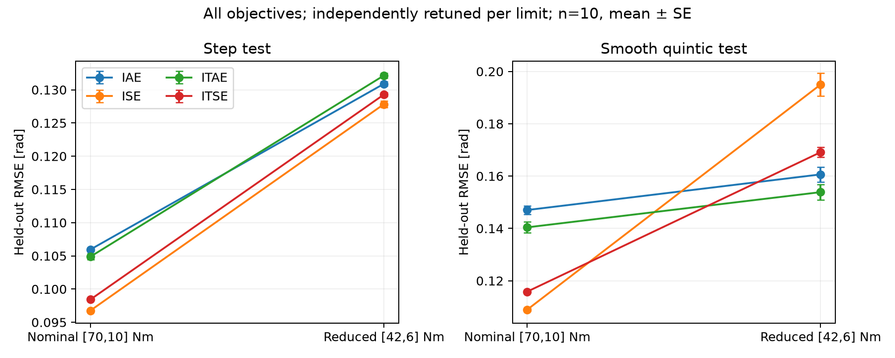
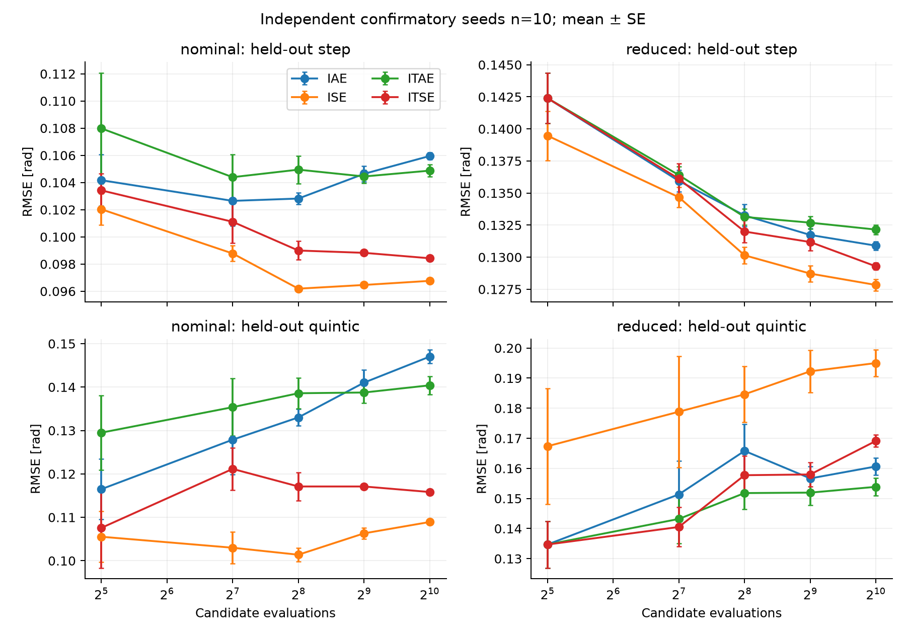
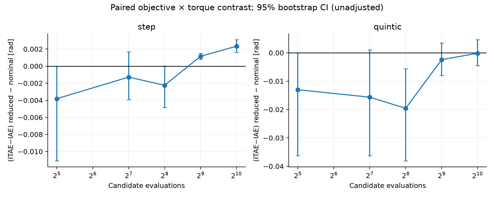
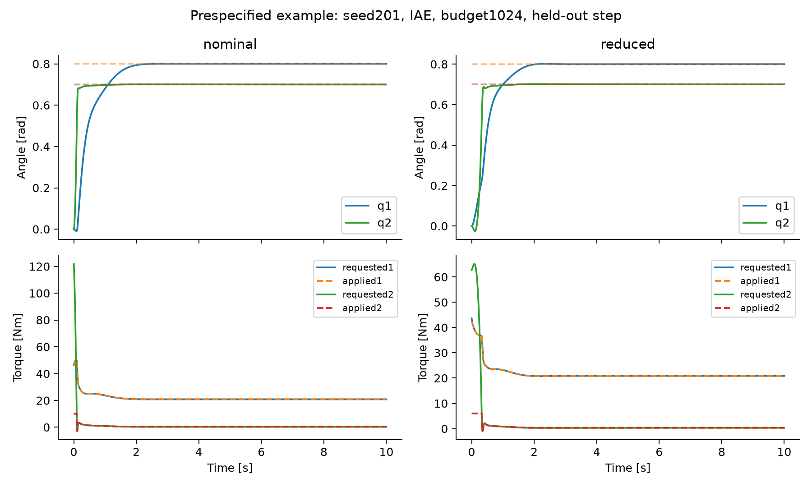

# KRoC 주제 엄밀 검토 — 실제 반복 실험 결과

**판정: 원래 범위의 제출은 보류하고, 계단 튜닝의 궤적 일반화 문제로 수정 후 조건부 채택을 권한다.** 구체적 이유와 추가 점검은 문서 끝의 판정에 기록한다. 이 보고서는 원문 수치 재현 논문이 아니라, 원문 물리 파라미터를 맞춘 보정 모델의 독립 실험이다. 상세 원문검토·실패원인·설계 이유는 [REVIEW_FOUNDATIONS_KO.md](../REVIEW_FOUNDATIONS_KO.md), 사전 조건은 [PROTOCOL.md](../PROTOCOL.md), 실행은 [README.md](../README.md)를 참조한다.

## 실제 완료 규모

총 104회 GA, 88,064개 candidate evaluations. 탐색용3seed×4목적함수×2토크×256=6,144후보, 확인용10seed×4×2×1,024=81,920후보. Checkpoint에서 train/held-out2궤적의 selected rollout 1,416회. 본 run 안에서 최종 held-out160조건의 base 재계산160회와 정밀화320회, representative trace2회가 추가된다. 따라서 본 run의 simulator 호출은 후보88,064 + checkpoint1,416 + refinement base160 + refinement320 + trace2 = 89,962회다. 모델검증,원문gain sanity와 실패한 컴파일 호출은 이 합계 밖의 별도 검증이다. 원문gain sanity12회, 모델검증 script 내부3회(재실행 횟수는 로그에 별도), 통계는 추가 simulator 호출이 아니다.

실행 wall time 1908.28초(31.80분), 초기 JIT와 최종파일쓰기 포함. 조합별 시간은 execution_times.csv. 실제 장소는 로컬 컴퓨터이며 GitHub Actions나 실물 로봇에서 실행한 것이 아니다. 처음 numba 컴파일 오류는 initial_compile_failure.log에 그대로 보존했다.

Numerical failure 후보 107개, training terminal tracking-feasible 후보 82166개. Numerical failure와 tracking infeasibility는 다르다. Final confirmatory held-out numerical failures는 0개. 실패 후보는 failed_candidates.csv에 gain·seed·조건과 함께 보존하며 교체 평가하지 않았다. Candidate budget은 총 simulator 호출수와 구분한다. Validation/test의 추가 rollout은 모든 arm에 같은 수다.

## 공정성과 독립성

초기32gain이 seed 내8조건에 정확히 같음을 archive로 검사했다. 선택gain은 해당 objective의 해당 budget까지의 최소 training score와 일치하고, own training incumbent는 모두 단조 개선했다. 실패·중복 후보도 예산에 포함된다. Gains가 upper/lower1% 경계에 붙는 비율은 audit.json을 참조한다. 최적해/탐색공간 충분성이나 수학적 전역 안정성은 보장하지 않는다. 동일 trajectory의 sample5000개를 통계 반복수로 쓰지 않았다. n=10은 optimizer seed 수다.

## 최종 예산1,024에서의 공통 독립 시험

Task1=새 계단[.8,.7]rad, Task2=새 quintic[1.2,.3]rad/2초 이동. 각 값은 독립 optimizer10seed의 산술평균이다. Saturation duty는 두 관절×전체 sample 중 requested/applied가 다른 비율이다. Tracking feasibility는 마지막 sampled error가 두 관절 모두≤.02rad인 비율이다. 이 조건은 전구간 safety constraint가 아니다. Peak는 각 rollout 최대 토크의 seed 평균이고, 어느 특정 actuator 정격이 아니다.

|task|condition|objective|rmse|iae|saturation_duty|tracking_feasible|peak_requested|peak_applied|
|---|---|---|---|---|---|---|---|---|
|1|nominal|IAE|0.105953|0.480394|0.00462|1|123.088|50.1741|
|1|nominal|ISE|0.0967635|0.496135|0.00621|1|139.068|57.3202|
|1|nominal|ITAE|0.104875|0.487438|0.00459|1|112.136|50.6463|
|1|nominal|ITSE|0.0984254|0.492179|0.00609|1|133.731|55.9217|
|1|reduced|IAE|0.130896|0.635682|0.01681|1|128.84|41.6961|
|1|reduced|ISE|0.127832|0.611093|0.01516|1|130.493|39.4776|
|1|reduced|ITAE|0.132152|0.656457|0.01733|1|101.084|41.8322|
|1|reduced|ITSE|0.129283|0.619873|0.01674|1|125.048|41.039|
|2|nominal|IAE|0.147023|1.11931|0|1|43.1909|43.1909|
|2|nominal|ISE|0.108924|0.789202|0|1|46.132|46.132|
|2|nominal|ITAE|0.140407|1.07405|0|1|42.6322|42.6322|
|2|nominal|ITSE|0.115825|0.851862|0|1|44.1464|44.1464|
|2|reduced|IAE|0.160648|1.28306|0.01686|1|42.9624|41.9951|
|2|reduced|ISE|0.19501|1.76077|0.01994|0.9|47.3796|42|
|2|reduced|ITAE|0.153867|1.22605|0.01495|1|42.0492|41.9761|
|2|reduced|ITSE|0.169135|1.3858|0.01928|1|44.9025|42|

서로 다른 objective의 raw 최솟값은 단위가 달라 비교하지 않는다. 이 표는 모두 같은 RMSE·IAE·토크 지표다. Raw 후보의 네 적분값은 candidates.csv.gz, 선택 gain과 모든 체크포인트 지표는 selected_metrics.csv에 있다. 정착시간은 두 관절이 .02rad 범위에 들어와 마지막 sample까지 유지하는 최초 시간, 미정착은 NaN으로 censor한다. 부드러운 궤적의 정착시간/오버슈트도 NaN이다. Metric summary의 count는 유효값 수이므로 정착한 경우만의 평균을 전체 정착성능처럼 해석하지 않는다.

## 사전에 정한 IAE–ITAE 비교 및 교호작용

아래 a=IAE,b=ITAE, nominal/reduced의 mean은 **ITAE−IAE RMSE**이다. 음수면 ITAE가 낮다. objective_x_torque는 (ITAE−IAE)reduced−(ITAE−IAE)nominal이다. 목적함수 차이가 토크 조건에 따라 달라지는지를 직접 추정한다. objective_x_budget은 최종budget과32회의 차이이고, 3way는 그 torque 대비까지의 차이다. 단순히 한 조건에서 p<.05이고 다른 조건에서 p>.05라는 이유로 교호작용을 주장하지 않는다.

|task|budget|contrast|n|mean|ci_low|ci_high|sign_flip_p|holm_p|
|---|---|---|---|---|---|---|---|---|
|1|256|nominal|10|0.00212722|0.000321643|0.00443419|0.0488281|0.0488281|
|1|256|reduced|10|-0.000117334|-0.00163276|0.000874823|0.988281|0.988281|
|1|256|objective_x_torque|10|-0.00224456|-0.00485117|2.26146e-05|0.136719|0.273438|
|1|1024|nominal|10|-0.00107748|-0.00174672|-0.000443809|0.0117188|0.0117188|
|1|1024|reduced|10|0.00125551|0.000773974|0.00174896|0.00390625|0.015625|
|1|1024|objective_x_torque|10|0.00233299|0.00163474|0.0030934|0.00195312|0.0117188|
|1|1024|objective_x_budget_nominal|10|-0.00489329|-0.011995|-0.000985954|0.00195312|0.0117188|
|1|1024|objective_x_budget_reduced|10|0.00125551|0.000766604|0.0017553|0.00390625|0.015625|
|1|1024|objective_x_torque_x_budget|10|0.0061488|0.00234601|0.0131346|0.00195312|0.0117188|
|2|256|nominal|10|0.00556887|-0.000649987|0.0128914|0.138672|0.138672|
|2|256|reduced|10|-0.014017|-0.0319096|-0.00145515|0.0546875|0.21875|
|2|256|objective_x_torque|10|-0.0195858|-0.0381218|-0.00561626|0.0195312|0.0390625|
|2|1024|nominal|10|-0.00661575|-0.00956936|-0.00393931|0.00195312|0.0117188|
|2|1024|reduced|10|-0.00678096|-0.00971512|-0.00387777|0.00390625|0.0117188|
|2|1024|objective_x_torque|10|-0.000165203|-0.00458705|0.0046021|0.953125|0.953125|
|2|1024|objective_x_budget_nominal|10|-0.0196378|-0.0423118|-0.00600581|0.00195312|0.0117188|
|2|1024|objective_x_budget_reduced|10|-0.00678096|-0.00967926|-0.00381002|0.00390625|0.0195312|
|2|1024|objective_x_torque_x_budget|10|0.0128568|-0.0021623|0.0359828|0.261719|0.867188|

CI는 seed단위 paired bootstrap10,000회, unadjusted95% percentile 구간이다. Sign-flip p는 paired contrast의 부호 교환에 대한 정확 열거이며 대칭성 가정이 필요하다. Holm은 같은 task/metric/budget/contrast의6목적함수쌍에 적용했고, 모든 budget·task를 한꺼번에 보정한 것은 아니다. 따라서 다수의 보조 결과를 확증적 발견으로 과장하지 않는다. 모든 RMSE·IAE 쌍별 대비와 실제 seed별 contrast는 각각 paired_contrasts.csv,paired_seed_values.csv에 있다.

최종1,024회의4목적함수 전체 torque교호작용:

|task|a|b|mean|ci_low|ci_high|holm_p|
|---|---|---|---|---|---|---|
|1|IAE|ISE|0.0061252|0.004916|0.00753895|0.0117188|
|1|IAE|ITAE|0.00233299|0.00163474|0.0030934|0.0117188|
|1|IAE|ITSE|0.00591427|0.00510854|0.00668542|0.0117188|
|1|ISE|ITAE|-0.00379221|-0.0056401|-0.00216847|0.0117188|
|1|ISE|ITSE|-0.000210925|-0.0014104|0.000696038|0.806641|
|1|ITAE|ITSE|0.00358128|0.00223695|0.00492855|0.0117188|
|2|IAE|ISE|0.0724609|0.0637715|0.0828066|0.0117188|
|2|IAE|ITAE|-0.000165203|-0.00458705|0.0046021|0.953125|
|2|IAE|ITSE|0.0396853|0.0341338|0.0460966|0.0117188|
|2|ISE|ITAE|-0.0726261|-0.0819886|-0.0653426|0.0117188|
|2|ISE|ITSE|-0.0327755|-0.0423103|-0.0257091|0.0117188|
|2|ITAE|ITSE|0.0398505|0.0343639|0.0460674|0.0117188|

## 목적함수별 필요한 예산

공통 RMSE .1rad에 최초 도달한 **관측 checkpoint**의 요약이다. Count는10seed 중 도달한 수, median/min/max는 도달한 seed만의 값이다. 미도달은 예산1024보다 크거나 이 설정에서 불가능할 수 있다. .05rad도 원자료에 있다. 이 threshold는 결과 요약용 추가 기술통계이며 연구 채택을 정한 사전 기준은 아니다. Test를 보고 gain을 재선택하지는 않았다. Checkpoint 간의 정확한 최소 예산, 하드웨어 시험 비용,실시간 최적화 가능성을 뜻하지 않는다.

|task|condition|objective|count|median|min|max|
|---|---|---|---|---|---|---|
|1|nominal|IAE|5|128|32|128|
|1|nominal|ISE|10|128|32|256|
|1|nominal|ITAE|3|128|32|128|
|1|nominal|ITSE|10|128|32|512|
|1|reduced|IAE|0|nan|nan|nan|
|1|reduced|ISE|0|nan|nan|nan|
|1|reduced|ITAE|0|nan|nan|nan|
|1|reduced|ITSE|0|nan|nan|nan|
|2|nominal|IAE|2|32|32|32|
|2|nominal|ISE|8|80|32|512|
|2|nominal|ITAE|1|32|32|32|
|2|nominal|ITSE|3|32|32|32|
|2|reduced|IAE|0|nan|nan|nan|
|2|reduced|ISE|0|nan|nan|nan|
|2|reduced|ITAE|0|nan|nan|nan|
|2|reduced|ITSE|0|nan|nan|nan|

## 수치·물리 검증

|kind|min_relative_change|max_relative_change|max_abs_relative_change|
|---|---|---|---|
|controller_refined|-0.00336793|-0.000337747|0.00336793|
|plant_refined|-4.96303e-12|4.98784e-12|4.98784e-12|

plant_refined는 controller dt=.002s를 유지하고 RK4 h=.001→.0005s, controller_refined는 controller dt=.002→.001s와 plant h=.001→.0005s를 함께 바꾼 것이다. 후자는 순수 ODE 오차와 sampled controller 변경을 구분해야 한다. 모든 최종 gain×두 held-out 궤적을 검사했고 상대변화 개별값은 integration_checks.csv에 있다. 정밀화에서 controller를 재최적화하지 않았다.

질량행렬의 양의 정부호, C의 kinetic-energy identity, G의 potential gradient, 정적중력 평형, 결정론적 동일trace, saturation 실제적용 검사를 통과했다(model_checks.json). 원문 인쇄 C·G의 일관성 결함도 수치 residual로 저장했다. 이 검증이 저자 실제 코드에 대한 오류 판정이나 모든 gain의 안정성 증명은 아니다.

## 산출물과 재현

그림의 budget errorbar는10seed 평균±SE이고 interaction errorbar는 paired bootstrap95%CI다. 예시 trace는 사전 고정seed201/IAE/budget1024/held-out step이며 가장 예쁜 결과를 골라낸 것이 아니다. 모든 결과를 그림 한 장에서 추론하지 말고 CSV를 함께 확인한다.

주요 파일: candidates.csv.gz, selected_metrics.csv, metric_summary.csv, paired_contrasts.csv, paired_seed_values.csv, integration_checks.csv, failed_candidates.csv, execution_summary.json, execution_times.csv, audit.json, model_checks.json, paper_gain_sanity.csv, trace_*.csv.gz. Config/seed/전체 dependency freeze/실행명령은 상위폴더에 있다. SHA256 manifest로 파일 무결성을 확인할 수 있다.

## KRoC4페이지 구성과 기여의 한계

1페이지: 문제와 기존 연구 중복, 제한된 토크 여유/평가예산에서 목적함수 선택이라는 질문. 2페이지: 보정 모델·PID·고정GA·조건·독립seed·train/test와 통계. 3페이지: 공통 RMSE의 budget곡선과 최종 feasibility/포화 표. 4페이지: paired 교호작용과 해석·한계·결론·참고문헌. 원문 재현 성공이나 신규최적화알고리즘을 주장하지 않는다. 표와그림을 줄여도 seed수/조건 선택 근거/재현범위는 생략하지 않는다.

추가 문헌에서도 Joyo(2019)의4종objective+관절포화, vanNiekerk(2026)의40회budget, Mishra(2026 preprint)의torque-aware IAE와antiwindup이 확인됐다. 상세접근수준과출처는 REVIEW_FOUNDATIONS_KO.md 및 additional_literature.json에 기록했다. 이 때문에 조건추가만으로 최초성·충분한신규성을 주장할 수 없다.

실물 검증이 없고 한point-mass plant·두test궤적·한GA·고정bounds에 한정된다. 현실의 마찰,모터전기동역학,기어/센서/전류/열·충돌 제약을 검증하지 않았다. 토크값은 하드웨어 식별값이 아니다. 목표 진폭과 horizon 변경·gain bounds 민감도도 아직 검증하지 않았다. 따라서 보정모델에서 큰효과가 보여도 일반적인 로봇팔 목적함수 추천으로 확장할 수 없다.

## 최종 판정: 원래 범위 그대로의 제출은 보류, 일반화 문제로 수정 후 조건부 채택

**연구를 폐기할 정도로 무효인 결과는 아니다. 하지만 ‘평가예산·토크 포화 조건에서 어떤 오차적분 목적함수가 가장 좋은가’라는 넓은 추천 논문으로 지금 제출하는 것은 권하지 않는다.** 공개 실험 artifact와 반복 가능한 현상은 확보했다. 핵심 질문을 **‘토크 제약 아래 계단응답으로 튜닝한 PID의 목적함수·평가예산이 새로운 이동 궤적의 성능에 미치는 영향’**으로 좁히는 것이 타당하다. 신규 알고리즘이나 원논문 수치 재현 성공을 기여로 내세우지 않는다.

### 실제 근거와 효과의 크기

1. Held-out smooth test에서 ISE는 nominal/reduced에서 RMSE **.108924→.195010rad**, IAE는 **.147023→.160648rad**였다. ISE는 IAE보다 nominal에서25.91% 낮고 reduced에서21.39% 높다. ISE−IAE 차이의 torque interaction은 **+.072461rad**, paired bootstrap95%CI **[.063771,.082807]**이다. 10개seed 모두 ISE와IAE의 상대순위가 반전했다. Leave-one-seed-out interaction은 .068314–.074421rad로, 한seed를 빼도 방향과규모가 유지됐다. 다만 IAE–ISE는 사전의 primary IAE–ITAE가 아니라 전체6쌍의 보조 비교이다. Holm p=.011719는 같은task/budget/contrast의6쌍에만 보정한 값이다. 이 결과를 보고 새 강조점을 골랐다는 사실을 숨기지 않는다.
2. Primary IAE–ITAE의 held-out step에서는 nominal에서 ITAE가 .001077rad 낮고, reduced에서 .001256rad 높다. Torque interaction **+.002333rad**,95%CI **[.001635,.003093]**였다. 통계적인 신호는 있지만 평균RMSE 약.10–.13rad에 비해 작은 차이다. 부드러운 궤적의 같은 대비는 **−.000165rad**,CI **[−.004587,.004602]**로 명확한 torque interaction이 없다. 따라서 ‘IAE–ITAE 순위반전이 모든 궤적에서 유지된다’는 주장은 틀리다.
3. 예산 증가는 training own-score를 항상 개선했으나 새로운 smooth test를 항상 개선하지 않았다. 예컨대 reduced/ISE의 testRMSE는32회 **.167354→1024회 .195010rad(+16.53%)**, nominal/IAE는 **.116473→.147023rad(+26.23%)**였다. 이 값은10seed평균이며, 더 적은예산의 일반적우월성을 뜻하지 않는다. 배치모집단32개에서1024개까지 특정 계단시험에 더 맞춘 결과가 새궤적에는 불리해질 수 있다는 신호다. Test를 보고 optimal checkpoint를 골라 gain을 재선택하지 않았다.
4. IAE–ITAE의 step 3way budget×torque interaction은 **+.006149rad**,CI **[.002346,.013135]**였지만 smooth에서는 **+.012857rad**,CI **[−.002162,.035983]**로 불확실하다. 넓은3요인 주장을 핵심기여로 삼기보다는 조건부결과로 보조 보고하는 것이 적절하다.

### 결과를 본 뒤 추가한 메커니즘·구현 점검

이 진단은 **탐색적 추가 분석**이다. 본실험의 조건과 결과를 바꾸지 않았다. 최종 gain 80개 × 배포 토크 2조건 × 미분 설정 2종으로 320회 추가 실행했고, 새로운 gain 최적화는 하지 않았다. 모든 값은 posthoc_crossover_and_derivative.csv에 보존했다.

**학습 토크와 시험 토크를 분리했다.** Nominal에서 학습한 ISE gain을 reduced 조건에 배포하면 smooth RMSE는 .108924에서 .116255 rad로 변한다. 반대로 reduced에서 학습한 ISE gain을 nominal 조건에 배포해도 .192665 rad로 크다. 큰 순위 반전의 대부분은 시험 중 순간 포화의 직접 효과보다, 제약 아래 계단 입력에 맞춘 gain과 새로운 궤적의 부합 문제에 가깝다. 이 평균들을 정확한 인과 기여율로 환산하지는 않는다. 조건마다 다시 튜닝한 본실험의 대비를 ‘시험 중 토크 포화만의 효과’라고 부르면 안 된다.

**미분 구현의 영향을 확인했다.** 본실험은 τ=Kp e+Ki∫e−Kd qdot, 즉 목표값 미분 가중치가 0인 PID/PI-D 구현이다. Smooth 목표의 미분값 Kd*rdot를 더하는 가중치 1도 고정 gain으로 시험했다. Nominal에서 ISE/IAE는 .092505/.118974 rad, reduced에서는 .167599/.133842 rad였다. 큰 상대순위 반전은 이 점검에서도 남는다. 다만 새 구현을 다시 튜닝한 비교는 아니며, 모든 PID 구현으로 일반화하지 않는다. 이상적인 계단 입력의 미분 impulse는 비교하지 않았다.

**수치 정밀화를 확인했다.** 제어 주기를 고정하고 plant 적분만 정밀하게 했을 때 최종 test RMSE의 최대 상대 변화는 약 5×10⁻¹²였다. 제어 주기도 절반으로 줄인 경우 최대 변화는 약 0.337%였다. 큰 순위 반전을 적분 오차로 설명하기는 어렵다. 제어 주기 변경과 ODE 적분 정밀화는 서로 다른 점검이다.

**실패와 추종 조건을 구분했다.** 후보 88,064개 중 수치 또는 상태 guard에 걸린 107개(약 0.12%)를 보존했다. 최종 확인용 시험 160회에는 이 실패가 없었다. Reduced/smooth/ISE는 마지막 오차가 두 관절 모두 .02 rad 이내인 조건을 9/10회 충족했고, 나머지 최종 조합은 10/10회 충족했다. 이 결과가 실물 안전성이나 전 구간 안정성을 증명하지는 않는다.

### 확보한 기여와 제출 전에 남은 문제

확보한 기여 후보는 물리적으로 일관성을 검사한 공개 2DOF benchmark, 공정한 평가 예산과 paired seed를 사용한 목적함수×토크 분석, 학습 성능과 새로운 궤적 성능의 구분, 시험 중 포화와 제약 아래 선택된 gain의 영향을 분리한 진단이다. 이 조합은 4페이지 실증 논문의 재료가 된다.

그러나 탐색 범위의 충분성을 확인하지 못했다. 최종 Ki1의 87.5%, Kp2의 45%가 각 범위의 상·하위 1% 경계에 있다. 이는 위·아래 경계를 합친 비율이다. 원문과 같은 범위를 사용한 공정한 비교이지만, 충분히 넓은 범위라는 증거는 아니다. 범위를 넓히거나 좁힌 재튜닝, 진폭 정규화, 평가 시간, 다른 plant·GA, 실제 actuator 정격을 사용한 실험은 수행하지 않았다. 반복 횟수를 늘리는 것만으로 이 외적 타당성 문제가 해결되지는 않는다.

다음 실험은 새로운 seed에서 **‘계단 입력만 학습’과 ‘이동 궤적을 포함한 학습’**을 비교하고 gain 범위의 민감도를 확인하는 것이 우선이다. 최종 시험에는 완전히 새로운 궤적을 남겨야 한다. 현재 smooth test는 이미 결과를 확인했으므로 다음 연구의 최종 독립 시험으로 재사용하면 안 된다. 이는 이번에 실행한 결과가 아니라, 제출 전 필요한 후속 검증이다.

Torque-aware objective로 바로 바꾸지는 않았다. 이번 설계에서 이미 반복 가능한 조건부 현상이 나타났고, 원하는 효과를 만들기 위해 목적함수를 바꿀 필요는 없었다. 토크 제곱이나 포화 비율 벌점 자체도 기존 연구에 있으므로, 가중 목적함수 하나를 더하는 것으로 신규성이 생기지는 않는다. 정확도·가속·열·토크 요구를 명시한 별도의 운용 문제가 있을 때 검토하는 것이 적절하다.

**최종 권고는 수정 후 조건부 채택이다.** ‘제약 아래 계단 튜닝의 궤적 일반화’로 연구 질문을 좁힐 것을 권한다. 현재 결과는 보편적인 목적함수 순위나 새로운 제어법의 우월성을 증명하지 않는다. 학습 궤적 구성과 gain 범위의 독립 검증 전에는 KRoC 최종 주제로 확정해 제출하지 않는 것이 엄밀하다. 다만 구체적인 수치와 공개 산출물은 확보했으므로, 연구 폐기보다 질문을 수정하는 쪽이 합리적이다.
