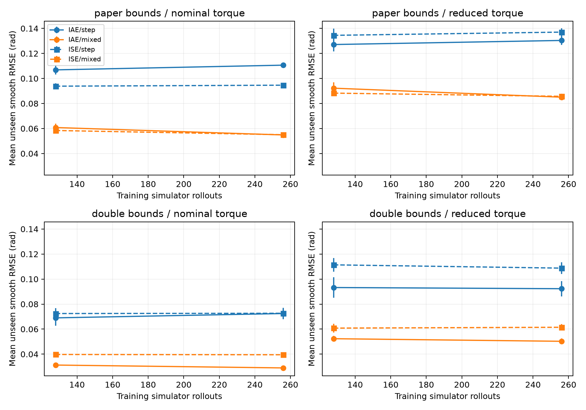
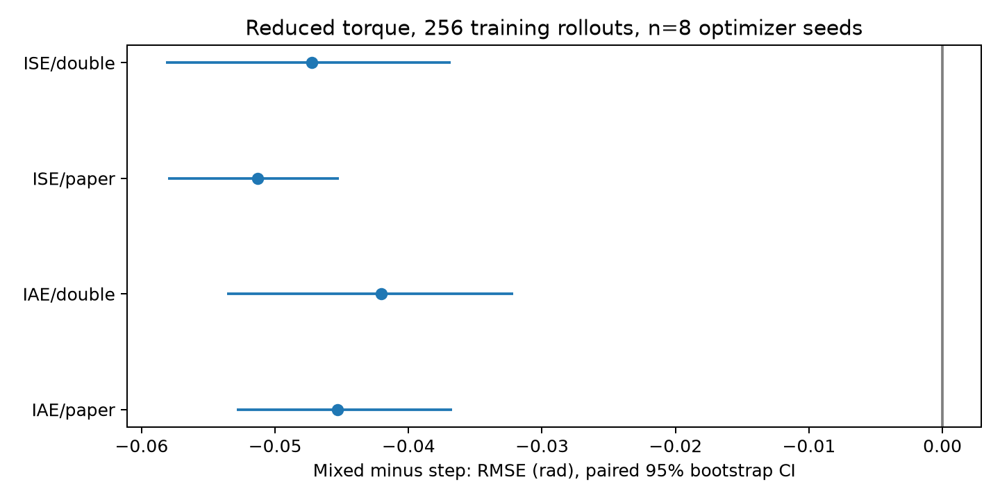
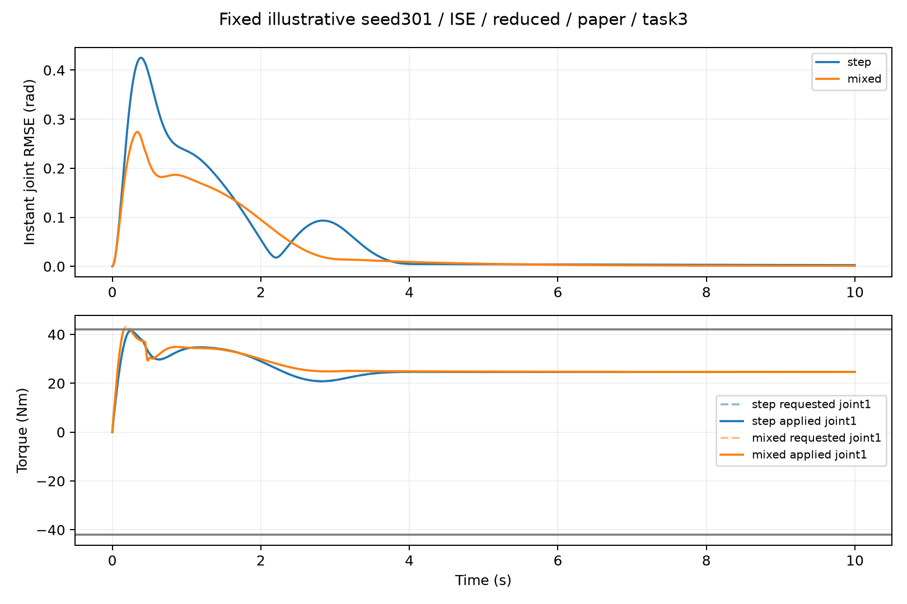

# KRoC 연구 탐색 추가 실행 결과 — 2026-11-10

**최종 판정: 주제 수정, 현재 형태의 제출 보류.** 이동 궤적 성능은 개선됐지만 새 계단에서는 19–28% 악화했다. 엄격한 신규성 평가·심사 점수·4페이지 구성과 최종 해석은 [VERDICT_KO.md](../VERDICT_KO.md)를 함께 읽어야 한다.

## 기존 결과와 이번 실행 구분

PR2(367544e)의 104GA/88,064후보는 **기존 완료 실험**이다. 이번 세션에서 원자료를 다시 읽고 47개 파일 해시를 검증했으며 IAE/ISE의 10/10seed 순위반전을 재확인했다. 그 전체 최적화를 다시 실행한 것으로 세지 않는다. 기존4목적함수×예산×토크 실험과 모든 부정적 결과는 상위 pilot/objective-budget-torque-20261110에 그대로 있다.

**이번 신규 실행**은 128GA, 24,576gain후보, 32,768학습 시뮬레이터 호출이다. 독립 시험 1,024회, 고정 제어주기의 적분 정밀화 512회, 대표 trace2회로 main follow-up 총 34,306호출이며, 별도 simulator 검증9호출은 이 합계 밖이다. 학습부터 시험·정밀화까지 실측 466.96초(7.78분), 학습구간 441.03초이다. Trace·검증·문헌·작성 시간은 이 wall time 밖이며, 쿼터/리셋이나 실물/Actions 실행을 주장하지 않는다.

## 부정적 1차 평가 후 실제 바꾼 설계

기존 broad 질문은 신규성 부족과 gain-bound/trajectory 혼입 때문에 그대로 채택하지 않았다. 원문을 재조사하고 새 질문을 **‘고정 시뮬레이션 실행비용에서 계단만 평가하는 대신 이동궤적을 함께 평가하면 새 궤적 성능이 좋아지며, 그 효과가 목적함수·토크·gain범위에 얼마나 의존하는가’**로 바꿨다. 과거 held-out task2는 이번 혼합학습에 사용하므로 더는 시험으로 취급하지 않는다.

새 seed301–308, IAE/ISE, nominal/reduced torque, 원문/double gain범위, step/mixed학습을 완전교차했다. 한GA의 학습비용128/256회 checkpoint. Step은256호출에256gain, mixed는128gain×2궤적=256호출이다. **후보수 같음과 실제 시뮬레이션 비용 같음을 혼동하지 않는다.** 이는 고정비용의 자원배분 비교이며, 궤적 다양성 하나의 순수 인과효과를 분리한 실험은 아니다. 동일 bounds 안에서 같은 normalized 초기32후보·seed·GA·물리모델·제어기·허용토크를 유지했다.

완전히 새로운 시험은 [.6,.9]rad/3s, [1,.6]/1s, [.9,.8]/4s의 quintic 이동3개와 [.6,.9]step이다. 각10s, 초기0, smooth는 이동후hold. Primary는3smooth RMSE의 seed별 산술평균이다. 최적화 전체 완료 후 시험을 실행했고 test로 gain이나checkpoint를 다시 선택하지 않았다. 조건파일은 실행 전에 작성하고 실행 중 결과를 보기 전에 a5c8460으로 기록했다. 과거 결과를 보고 설계한 탐색적 후속실험이므로 독립적인 사전등록 발견이라고 부르지 않는다.

## 새 독립시험의 실제 수치

최종256학습호출, optimizer8seed×3smooth 평균. RMSE단위rad; tracking_feasible는 sampled 마지막오차 두관절≤.02rad의 비율이며 전구간 안전성과 다르다.

| objective | condition | bound | training | rmse | tracking_feasible | saturation_duty |
|---|---|---|---|---|---|---|
| IAE | nominal | double | mixed | 0.0289951 | 1 | 0 |
| IAE | nominal | double | step | 0.0724715 | 1 | 0 |
| IAE | nominal | paper | mixed | 0.0548578 | 1 | 0 |
| IAE | nominal | paper | step | 0.110642 | 1 | 0 |
| IAE | reduced | double | mixed | 0.0502793 | 1 | 0.026375 |
| IAE | reduced | double | step | 0.0923068 | 1 | 0.01865 |
| IAE | reduced | paper | mixed | 0.0850546 | 1 | 0.0366792 |
| IAE | reduced | paper | step | 0.130397 | 1 | 0.0207583 |
| ISE | nominal | double | mixed | 0.0395066 | 1 | 0 |
| ISE | nominal | double | step | 0.0726733 | 1 | 0 |
| ISE | nominal | paper | mixed | 0.0550516 | 0.958333 | 0 |
| ISE | nominal | paper | step | 0.0946368 | 1 | 0 |
| ISE | reduced | double | mixed | 0.0614945 | 1 | 0.0140208 |
| ISE | reduced | double | step | 0.108762 | 1 | 0.0155458 |
| ISE | reduced | paper | mixed | 0.0857431 | 1 | 0.0329333 |
| ISE | reduced | paper | step | 0.137053 | 1 | 0.0203542 |

## 고정한 네 primary 대비

Reduced torque에서 mixed−step RMSE, 음수면 mixed가 좋다. 상대변화는 두방법의 평균RMSE 비율이다. negative_seeds는8개seed 중 mixed가 낮은 수다.

| objective | bound | step_rmse | mixed_rmse | relative_change_percent | mean | ci_low | ci_high | sign_flip_p | holm_primary_p | negative_seeds |
|---|---|---|---|---|---|---|---|---|---|---|
| IAE | paper | 0.130397 | 0.0850546 | -34.7727 | -0.0453427 | -0.0528413 | -0.0367431 | 0.0078125 | 0.03125 | 8 |
| IAE | double | 0.0923068 | 0.0502793 | -45.5303 | -0.0420275 | -0.0536054 | -0.0321485 | 0.0078125 | 0.03125 | 8 |
| ISE | paper | 0.137053 | 0.0857431 | -37.4379 | -0.0513097 | -0.0580008 | -0.0452388 | 0.0078125 | 0.03125 | 8 |
| ISE | double | 0.108762 | 0.0614945 | -43.4595 | -0.0472673 | -0.0581719 | -0.0368508 | 0.0078125 | 0.03125 | 8 |

95%CI는 paired optimizer-seed bootstrap10,000회 percentile이며 다중보정하지 않았다. p는8seed 부호의 전체256가지 조합을 이용한 exact sign-flip이고 contrast분포 대칭성 가정이 필요하다. Holm은 표의4primary 비교에만 적용했다. 궤적3개나5000time samples를 독립 optimizer 반복으로 부풀리지 않았다. n=8이며 CI는 하드웨어/로봇모집단의 불확실성을 나타내지 않는다. 총예산256의 저예산 민감도이므로 기존1024결과의 동등규모 반복은 아니다.

## 부정적 결과: 새 계단 시험의 손해

아래는 reduced torque/256회 비용에서 mixed−step RMSE이다. 네 조건 모두 8/8 seed에서 혼합 학습이 나빴다. 이 표는 결과 확인 후 추가한 보조 분석이며, p와 CI는 다중보정하지 않았다. 이동 궤적의 개선을 전반적 성능 개선으로 쓰면 안 된다.

| objective | bound | step_rmse | mixed_rmse | relative_change_percent | n | mean | ci_low | ci_high | sign_flip_p | negative_seeds |
|---|---|---|---|---|---|---|---|---|---|---|
| IAE | paper | 0.12413 | 0.159218 | 28.2669 | 8 | 0.0350878 | 0.0322611 | 0.0376288 | 0.0078125 | 0 |
| IAE | double | 0.128235 | 0.164641 | 28.3896 | 8 | 0.0364055 | 0.0320697 | 0.041041 | 0.0078125 | 0 |
| ISE | paper | 0.124915 | 0.155739 | 24.6759 | 8 | 0.0308239 | 0.0261546 | 0.035271 | 0.0078125 | 0 |
| ISE | double | 0.121953 | 0.145272 | 19.1216 | 8 | 0.0233194 | 0.0195085 | 0.0270138 | 0.0078125 | 0 |

## 목적함수×토크, 예산과 범위의 직접 교호작용

아래 objective_x_torque=(ISE−IAE)reduced−(ISE−IAE)nominal이다. training/budget/bounds 대비는 이 값을 직접 차분한 것이다. 한조건의p만 유의하고 다른조건은 그렇지 않다는 이유로 교호작용을 주장하지 않는다. 이 표는 **보조 탐색 결과이며 다중비교 보정하지 않았다**.

| bound | training | budget | kind | n | mean | ci_low | ci_high | sign_flip_p | negative_seeds |
|---|---|---|---|---|---|---|---|---|---|
| paper | step | 128 | objective_x_torque | 8 | 0.0203919 | 0.00768476 | 0.0367218 | 0.015625 | 0 |
| paper | step | 256 | objective_x_torque | 8 | 0.0226604 | 0.0116617 | 0.036002 | 0.0078125 | 0 |
| paper | mixed | 128 | objective_x_torque | 8 | -0.00158724 | -0.00576174 | 0.00309117 | 0.5 | 5 |
| paper | mixed | 256 | objective_x_torque | 8 | 0.000494715 | -0.00457496 | 0.00579704 | 0.859375 | 4 |
| double | step | 128 | objective_x_torque | 8 | 0.0146692 | 0.0033005 | 0.0264095 | 0.0625 | 1 |
| double | step | 256 | objective_x_torque | 8 | 0.0162533 | 0.00443954 | 0.02919 | 0.0625 | 3 |
| double | mixed | 128 | objective_x_torque | 8 | 7.43173e-06 | -0.00962715 | 0.00959003 | 1 | 4 |
| double | mixed | 256 | objective_x_torque | 8 | 0.000703783 | -0.00722756 | 0.00572011 | 0.9375 | 1 |
| paper | mixed-minus-step | 256 | training_x_objective_x_torque | 8 | -0.0221657 | -0.0370976 | -0.012218 | 0.0078125 | 8 |
| paper | step | 256 | budget_x_objective_x_torque | 8 | 0.00226852 | -0.013309 | 0.0162661 | 0.789062 | 4 |
| paper | mixed | 256 | budget_x_objective_x_torque | 8 | 0.00208196 | -0.00394476 | 0.00799581 | 0.546875 | 4 |
| double | mixed-minus-step | 256 | training_x_objective_x_torque | 8 | -0.0155495 | -0.0278951 | -0.00346367 | 0.0546875 | 6 |
| double | step | 256 | budget_x_objective_x_torque | 8 | 0.00158401 | -0.00899543 | 0.013892 | 0.835938 | 4 |
| double | mixed | 256 | budget_x_objective_x_torque | 8 | 0.000696352 | -0.00644221 | 0.0077257 | 0.929688 | 5 |
| double-minus-paper | step | 256 | bounds_x_objective_x_torque | 8 | -0.00640713 | -0.0258266 | 0.0152136 | 0.539062 | 6 |
| double-minus-paper | mixed | 256 | bounds_x_objective_x_torque | 8 | 0.000209068 | -0.0112379 | 0.0085612 | 1 | 2 |

## 실행 공정성과 모델 검증

모든 선택gain이 해당조건·예산까지의 training최솟값인지 archive로 재검사했고, 각seed의 초기normalized32gain도 재생성해 검사했다. 실패·중복도예산에 포함하며 실패후보 45개를 failed_candidates.csv로 별도 보존했다. 전체checkpoint시험 수치/guard실패 0개, 정밀화실패 0개. Tracking infeasibility와 numerical/state-guard 실패는 다른 지표다.

제어주기.002s를 유지하고 RK4 내부.001→.0005s로 정밀화했을 때 모든최종128gain×4task의 RMSE 최대상대변화는 1.74337e-10였다. 새실험에서는 제어주기를 바꾼 재튜닝은 하지 않았다. 기존3task 출력은 이전코드와 bitwise동일, 새smooth endpoint와 실제적용토크clip 확인, 100상태에서 최소질량행렬고유값 0.0228078, 최대energyidentity residual 4.25545e-10, 중력potential gradient검사를 통과했다.

물리파라미터는 Eltayeb와 맞췄으나 인쇄C/G를 보정한 coupled2DOF point-mass plant이다. GA pop32/돌연변이/solver/antiwindup도 원문구현과 동일복원한 것이 아니다. 원문Simulink 표 수치 재현이나 원문보다 몇%향상했다는 주장은 할 수 없다. 새 범위 [400,100,20]는 탐색 민감도이며 실제actuator정격이 아니다. Gain경계비율은 gain_boundary_fraction.csv에 모두 기록했다. 범위를2배로 바꿨다는 것만으로 최적탐색공간이 충분하다는 증거는 아니다.

초기자세0는 수평이며중력이0이 아니다. 적분초기값0, 중력feedforward없음, filteredderivative/센서노이즈/모터전기·기어·마찰·열모델없음. Smooth시작에서 중력처짐이 포함되므로 결과를 gravity-compensated 산업용servo로 일반화하지 않는다. 정밀한ODE계산과 실물모델타당성은 별개다.

## 선행연구와 정량 기여의 경계

이번에 [Eltayeb2024](https://www.mdpi.com/2673-4052/5/3/14), [Joyo2019](https://www.mdpi.com/2079-9292/8/8/826)의 publisher전문, [Roveda2020 저자원문](https://ipg.idsia.ch/preprints/roveda2020a.pdf)의5.6절/Fig11, [Navarro-Cabrera2023 v1](https://arxiv.org/html/2309.08988)의III–IV절을 확인했다. 4objective+포화, 궤적별최적화, 풍부한학습궤적의다른궤적일반화는 이미다뤄졌다. 접근수준·겹치는질문·모델차이는 LITERATURE_KO.md에기록했다. 선택적문헌조사이며 전세계최초성을검증하지않았다.

이번의 정량기여후보는 **자체모델의 고정rollout비용아래 학습자원배분 효과와 목적함수/범위민감도를 분리해 수치와부정적결과를 공개한 것**이다. 선행논문의다른로봇·다른지표보다 성능이우수하다는 외부benchmark 결과는확보하지못했다.

## 그림과 재현

Budget그림은8seed 평균±SE, primary그림은paired95%CI다. 대표trace는seed301/ISE/reduced/paper/task3의step/mixed이며 가장좋은seed를고른것이아니다. FullCSV, config, 실행log, 환경freeze, 재현명령은같은폴더에있다. 기존main/PR1/PR2는수정하지않았다.
