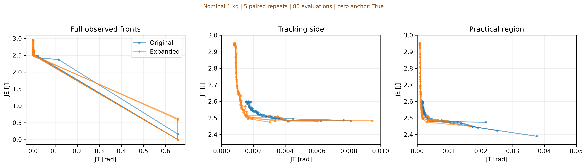
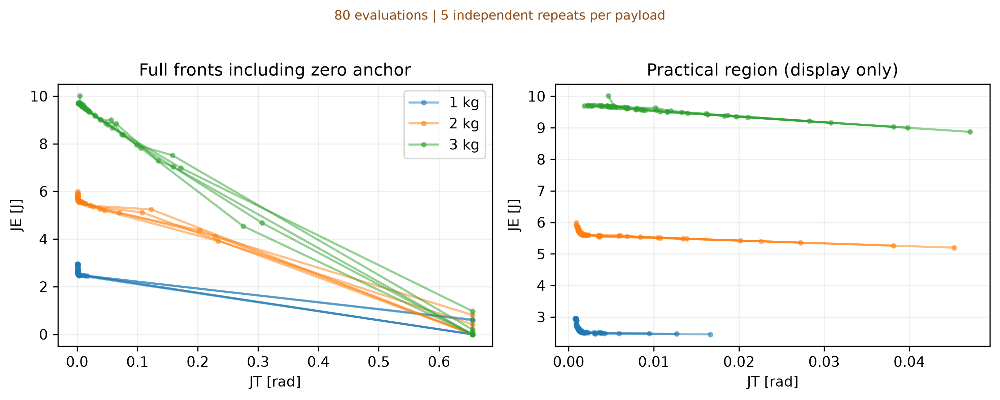
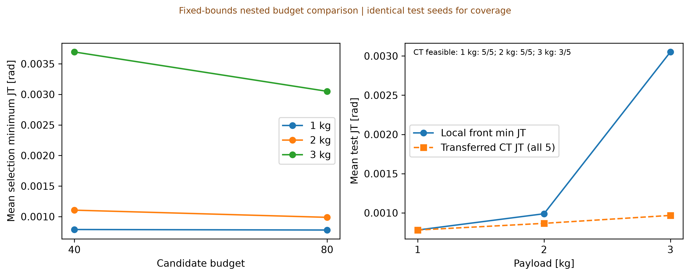
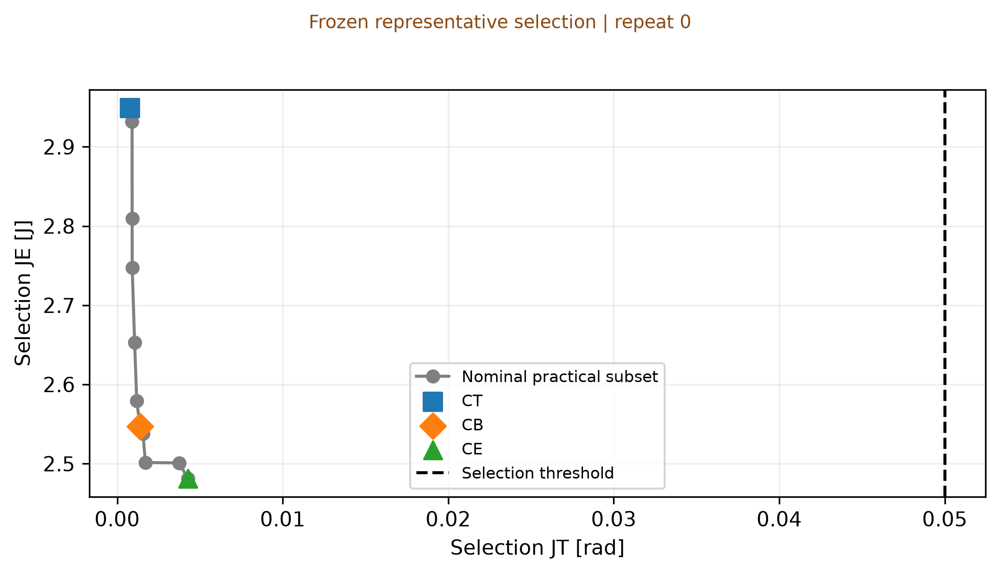
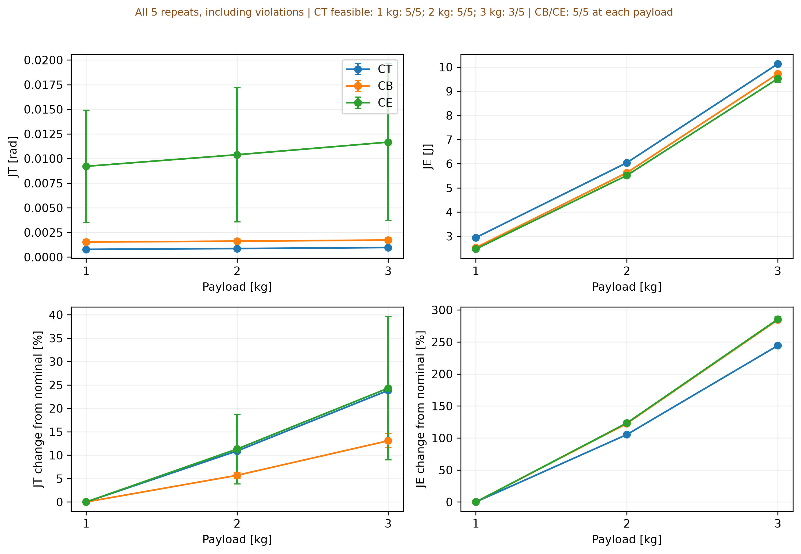

# Canonical final — 80-evaluation follow-up (2026-09-27)

## Decision and primary findings

- 1 kg, paired 80-evaluation bound comparison: mean minimum JT decreased from 0.00157706 to 0.00078041 rad (50.51%), while CT energy increased 13.40% (2.59846→2.94673 J). Decision: expanded bounds; expanded CT attached to its upper bound in 5/5 repeats.
- At fixed selected bounds, extending the same candidate sequence from 40 to 80 evaluations reduced mean minimum JT by 1 kg: 1.05%; 2 kg: 10.63%; 3 kg: 17.43%.
- On identical test seeds, transferred CT had lower JT in 10/10 heavy-payload comparisons, but only 8/10 transfers were feasible. All 8/8 feasible transfers beat the observed feasible local tracking extreme; infeasible transfers are excluded from this coverage-gap evidence.
- Without retuning, CT at 3 kg had JT=0.0009673 ± 1.3301e-06 rad and JE=10.134 ± 0.0022272 J across all five repeats, including two current-limit violations; these are not five feasible outcomes. Changes from its own nominal response were 23.834 ± 0.059293% and 244.41 ± 0.32102%.
- CE at 3 kg achieved JT=0.011664 ± 0.0079572 rad and JE=9.5221 ± 0.16161 J. Physical feasibility held in 43/45 representative conditions; JT≤0.05 rad alone held in 45/45, and both requirements held in 43/45. CT at 3 kg was feasible in 3/5 repeats. Zero PID was selected for 0/15 representative roles.

The >=5% threshold was fixed before the new data in `docs/BUDGET80_PROTOCOL.md`. Adopted upper bounds: **[800.0, 400.0, 80.0]**. Both sensitivity arms used 80 evaluations, 10 initial points (one zero-PID anchor plus nine Sobol), qLogNEHVI, and five paired optimizer repeats. All three gain bounds changed together, so this comparison does not isolate the effect of Kp alone. The canonical experiment was then rerun from scratch at the chosen bounds for all three payloads. The runs were executed locally against the GitHub repository; manifests identify the actual platform and source revision.

## Model and evaluation protocol

This is the canonical **1-DOF geared-joint simulation**, not a coupled 3-DOF hardware experiment. Physical values remain unchanged: Maxon RE35 323890, GP42C N=126, constant eta=0.72; R=0.568 ohm, L=0.000191 H, Kt=0.0292 Nm/A, Ke=0.0291 Vs/rad; Jm=8.12e-6, Jg=1.4e-6 kg m² (input-side); 0.20 m / 0.50 kg link, COM=0.10 m, tip payload radius=0.20 m; b=0.05, g=9.81. These are user-specified model parameters, not hardware identification results.

Full 5 s quintic 0→60° trajectory, no hold. JT is true-angle RMSE [rad]; JE is signed integral V i dt [J]. Voltage clips at ±24 V; |current|≤3.84 A is a feasibility constraint, **not current clipping**. Numerical settings: 1 ms control interval, RK4 16 substeps, PID filter 20 ms, antiwindup gain 10/s. Noise power=1e-10 rad²s, sample period=1 ms. Train/selection/test replicates are 3/5/10 with disjoint phase seeds; the full frozen configuration and every seed are saved.

Experiment 1 uses 5×3×80=1,200 candidates, including infeasible attempts; all are independently reevaluated on selection seeds. No nominal controller is inserted post hoc into a target local front. HV and retention are supplementary only.

## Bounds: performance and actuator evidence

| repeat | original_min_JT | expanded_min_JT | improvement_pct | expanded_CT_at_upper |
| --- | --- | --- | --- | --- |
| 0 | 0.00156159 | 0.000777666 | 50.2003 | True |
| 1 | 0.00155089 | 0.000783377 | 49.4884 | True |
| 2 | 0.00167728 | 0.000780528 | 53.4646 | True |
| 3 | 0.00154615 | 0.000778803 | 49.6295 | True |
| 4 | 0.00154942 | 0.000781688 | 49.5496 | True |

| arm | voltage_saturation_mean | voltage_saturation_max | peak_current_max_A | CT_JT_mean | CT_JE_mean |
| --- | --- | --- | --- | --- | --- |
| expanded | 0 | 0 | 2.73599 | 0.000780413 | 2.94673 |
| original | 0 | 0 | 1.70076 | 0.00157706 | 2.59846 |

Voltage saturation was absent in all ten selected sensitivity CTs. The bound effect cannot be attributed to voltage saturation. Peak current is compared with 3.84 A, not interpreted as an implemented current limiter. Expanded-bound attachment remains a limitation; this is not proof of gain convergence. Regional front distances and practical-region energy are reported in the sensitivity CSVs; all fronts retain the zero-PID point.

The mean minimum observed energy subject to JT≤0.05 rad was 2.440106 J at current bounds and 2.471374 J at expanded bounds. Tracking improvement does **not** establish uniform dominance of the practical front. Finite-budget exploration over a larger search domain can alter energy-side coverage.

## Experiment 1 and budget effect

| payload | min_JT_mean | min_JT_SD | feasible_mean | pareto_mean |
| --- | --- | --- | --- | --- |
| 1 | 0.000780413 | 2.26724e-06 | 72.8 | 14.6 |
| 2 | 0.000987971 | 9.5676e-05 | 71.6 | 14.6 |
| 3 | 0.00304995 | 0.00111659 | 71 | 16.4 |

The following comparison uses the first 40 candidates versus all 80 in each new canonical run, at the **same bounds and selection seeds**. It isolates the extra search budget within this run; old 400-bound/40-evaluation results are archived separately and are not confounded with a simultaneous bound change. The table's improvement_pct is the mean of repeat-level percentages; headline budget percentages are computed from the two repeat means. Neither is a statistical significance claim.

| payload | JT_40 | JT_80 | improvement_pct |
| --- | --- | --- | --- |
| 1 | 0.000788722 | 0.000780413 | 1.0391 |
| 2 | 0.0011055 | 0.000987971 | 9.89343 |
| 3 | 0.00369384 | 0.00304995 | 17.2265 |

| payload | local_JT | transfer_JT | lower_transfer_JT_count | feasible_transfer_count | feasible_transfer_better_count |
| --- | --- | --- | --- | --- | --- |
| 1 | 0.000781123 | 0.000781123 | 0 | 5 | 0 |
| 2 | 0.000988772 | 0.000866285 | 5 | 5 | 5 |
| 3 | 0.00305118 | 0.000967295 | 5 | 3 | 3 |

Remaining local-versus-transfer reversals, if any, must remain visible. Eighty evaluations do not establish global optimality or guarantee adequate tracking-side coverage. Local observed fronts and transfer fronts are finite-budget observations.

Only feasible transfers provide valid evidence of better feasible tracking than the local front. Two infeasible 3 kg CT transfers have low JT but cannot support that comparison. Coverage counts above therefore separate raw lower-JT counts from feasible lower-JT counts.

## Representative selection and Experiment 2

The practical criterion JT≤0.05 rad is predefined **only for representative selection; it does not truncate the Pareto front**. Exclude [0,0,0]. CT minimizes JT; CE minimizes JE within the practical subset; CB minimizes Euclidean distance to utopia after min/max normalization of JT and JE over that subset. Ties use objectives then gains as recorded in `selection_rule.json`; coincident roles are allowed and explicitly reported. Gains are frozen from nominal selection data before target testing. Selection JT/JE below differ legitimately from disjoint test estimates.

| repeat | role | kp | ki | kd | JT | JE | utopia_distance | selection_status |
| --- | --- | --- | --- | --- | --- | --- | --- | --- |
| 0 | CT | 800 | 400 | 0 | 0.000777666 | 2.94889 | 1 | ok |
| 0 | CB | 281.907 | 364.002 | 0 | 0.00138254 | 2.54672 | 0.222846 | ok |
| 0 | CE | 0 | 185.823 | 0 | 0.00426191 | 2.4814 | 1 | ok |
| 1 | CT | 800 | 400 | 0 | 0.000783377 | 2.95004 | 1 | ok |
| 1 | CB | 133.132 | 333.044 | 0 | 0.00181513 | 2.5081 | 0.133827 | ok |
| 1 | CE | 68.6112 | 0 | 0 | 0.0166363 | 2.44958 | 1 | ok |
| 2 | CT | 800 | 400 | 0 | 0.000780528 | 2.95099 | 1 | ok |
| 2 | CB | 138.23 | 400 | 0 | 0.00154243 | 2.50841 | 0.112959 | ok |
| 2 | CE | 90.2263 | 0 | 0 | 0.0126709 | 2.46302 | 1 | ok |
| 3 | CT | 800 | 400 | 0 | 0.000778803 | 2.94378 | 1 | ok |
| 3 | CB | 320.27 | 400 | 0 | 0.00124137 | 2.5609 | 0.27246 | ok |
| 3 | CE | 0 | 346.108 | 0 | 0.00315833 | 2.47056 | 1 | ok |
| 4 | CT | 800 | 400 | 0 | 0.000781688 | 2.93995 | 1 | ok |
| 4 | CB | 191.461 | 339.612 | 0 | 0.00165007 | 2.51942 | 0.128185 | ok |
| 4 | CE | 0 | 83.8031 | 0 | 0.00947956 | 2.48265 | 1 | ok |

Primary test results (mean ± SD across five optimization repeats; deltas calculated per controller against its own 1 kg test response before averaging):

| role | payload | JT_rad | JE_J | delta_JT_pct | delta_JE_pct | feasible | tracking_only | feasible_and_practical |
| --- | --- | --- | --- | --- | --- | --- | --- | --- |
| CT | 1 | 0.00078112 ± 1.1734e-06 | 2.9425 ± 0.0033398 | 0 ± 0 | 0 ± 0 | 5/5 | 5/5 | 5/5 |
| CB | 1 | 0.0015278 ± 0.00022283 | 2.5286 ± 0.02407 | 0 ± 0 | 0 ± 0 | 5/5 | 5/5 | 5/5 |
| CE | 1 | 0.0092125 ± 0.0057004 | 2.4697 ± 0.013782 | 0 ± 0 | 0 ± 0 | 5/5 | 5/5 | 5/5 |
| CT | 2 | 0.00086629 ± 1.2534e-06 | 6.0416 ± 0.0027968 | 10.902 ± 0.0304 | 105.32 ± 0.1387 | 5/5 | 5/5 | 5/5 |
| CB | 2 | 0.0016139 ± 0.0002273 | 5.6291 ± 0.023563 | 5.6959 ± 0.67125 | 122.63 ± 1.183 | 5/5 | 5/5 | 5/5 |
| CE | 2 | 0.010387 ± 0.0068062 | 5.5167 ± 0.065491 | 11.322 ± 7.4589 | 123.37 ± 1.4359 | 5/5 | 5/5 | 5/5 |
| CT | 3 | 0.0009673 ± 1.3301e-06 | 10.134 ± 0.0022272 | 23.834 ± 0.059293 | 244.41 ± 0.32102 | 3/5 | 5/5 | 3/5 |
| CB | 3 | 0.0017255 ± 0.00023397 | 9.7244 ± 0.022742 | 13.08 ± 1.4891 | 284.6 ± 2.7515 | 5/5 | 5/5 | 5/5 |
| CE | 3 | 0.011664 ± 0.0079572 | 9.5221 ± 0.16161 | 24.307 ± 15.343 | 285.53 ± 4.4592 | 5/5 | 5/5 | 5/5 |

**Constraint violations are retained, not removed or retuned:**

| repeat | role | payload | JT | JE | max_current | violation |
| --- | --- | --- | --- | --- | --- | --- |
| 0 | CT | 3 | 0.000969385 | 10.135 | 4.05478 | current |
| 1 | CT | 3 | 0.000966094 | 10.1366 | 3.88431 | current |

The 3.84 A peak-current criterion is evaluated across all ten test rollouts in each condition. Both violations occurred without voltage saturation. The JT-only requirement holds in all 45 conditions, whereas physical feasibility and the combined practical flag hold in 43/45. Reported CT 3 kg mean/SD include the two violations and must not be presented as five feasible controllers. All CB/CE conditions remained feasible. Nominal feasible selection therefore does not guarantee cross-payload current feasibility.

`representative_performance.csv` preserves all 45 conditions and feasibility. Per-repeat angle/current/voltage/power plots accompany the report. Retention and HV are in `table2_transfer_across_repeats.csv` and related figures as **supplementary metrics**, not primary evidence for payload ordering or robustness.

## Verification and provenance

680 independent consistency checks passed: full candidate counts, anchor placement, raw-to-aggregate objective reproduction, execution-source hashes, reproducible selection, frozen gains and nominal-relative deltas. See `audit.json`; test-suite results and numerical refinement checks are saved separately. These checks validate implementation consistency, not hardware validity.

The prior canonical report is preserved at `reports/archive/canonical-final-20260924-budget40`; the original 2026-09-23 archive is also retained. `raw-results.zip` contains both sensitivity arms, the selected canonical run, raw rollouts, traces, config/seed/manifest files, and the exact execution-source snapshot. `PROVENANCE.json` and `ARTIFACTS.sha256.json` identify paths and content hashes. No Experiment 3 was performed.

Reproduce with `python analysis/run_budget80.py --out results/new-budget80`, then `python analysis/report_budget80.py --root results/new-budget80 --out reports/new-budget80`. Existing destinations are refused. The runner explicitly reconstructs both 400 and 800 arms irrespective of the final canonical bound setting.

## Limitations

- No hold segment: conclusions cover only the finite 5 s movement, not long-term holding energy or settling after 5 s.
- Constant gear efficiency eta=0.72; no speed/load-dependent efficiency map.
- No thermal, backlash, or detailed driver model; no current-clipping implementation or hardware validation.
- One-DOF simulation, fixed trajectory and prescribed noise model; no coupled 3-DOF validation.
- Finite optimization budget and five repeats. Upper-bound attachment and local tracking coverage must not be presented as resolved unless the data demonstrate this. No statistical significance claim from the 5% engineering threshold.

## Revision 4 supplementary diagnostics (completed 2026-10-01; packaged 2026-10-03)

The main 80-evaluation Experiment 1/2 results and frozen representatives above remain the primary run. Bounds are retained at [800,400,80] as a scope/budget decision. The complete [supplementary report](../heavy-diagnostics-20261001/REPORT.md) and [revision 1–4 history](../../docs/REVISION_HISTORY.md) record the added experiments.

| Payload | Mean feasible selection min JT at 80 [rad] | At 160 [rad] | Improvement |
|---|---:|---:|---:|
| 2 kg | 0.000987971 | 0.000897435 | 9.16% |
| 3 kg | 0.003049954 | 0.002228699 | 26.93% |

Both improvements exceed the predeclared 5% threshold: tracking coverage remains sensitive to budget at 80 evaluations. The 160-evaluation observations do not establish convergence or the true Pareto front. These are continuations of the original five 80-evaluation histories per payload (800 new candidates total).

A separate 40-candidate constrained JT-only diagnostic, warm-started with nominal CT, found no feasible candidate with lower paired mean JT than CT on fresh confirmation seeds (0/5 repeats at each payload). This finite-budget null result does not show that a better feasible PID does not exist. CT and SO40 each pass feasibility in only 3/5 fresh 3 kg conditions; infeasible low-JT transfers are not evidence of feasible superiority.

Actuator current constraints limit the applicability of aggressive controllers; neither voltage-saturation convergence nor a constrained global optimum is established. The current constraint is evaluated without current clipping. No hold, constant gear efficiency, and no thermal/backlash/detailed driver model remain limitations. No Experiment 3 was performed. The prior main report is preserved in [the 80-evaluation archive](../archive/canonical-final-20260927-budget80/REPORT.md).
