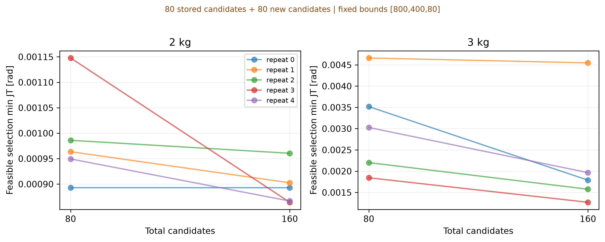
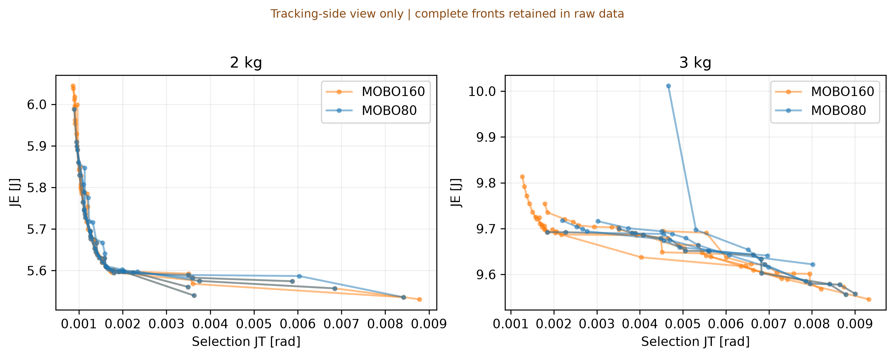
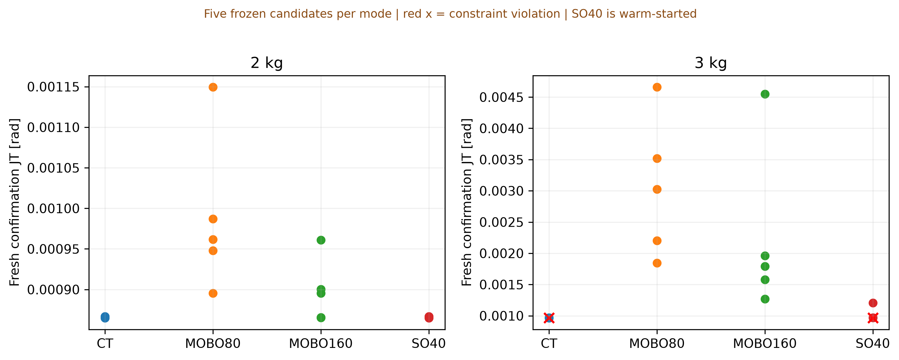

# 2/3 kg supplementary diagnostics — revision 4 (2026-10-01)

## Scope and decisions

Canonical bounds remain **[800,400,80]**. The main 80-evaluation Experiment 1/2 and its frozen controllers remain unchanged. These are supplementary diagnostics, not Experiment 3 and not evidence of optimizer superiority. Current-limit violations constrain cross-payload applicability; no voltage-saturation limit or global constrained optimum has been established.

- 2 kg: mean feasible selection min JT 0.00098797→0.00089744 rad, improvement 9.16%; material_budget_sensitivity.
- 3 kg: mean feasible selection min JT 0.00304995→0.00222870 rad, improvement 26.93%; material_budget_sensitivity.
- SO40 at 2 kg on fresh seeds: feasible 5/5, lower mean JT than CT 0/5, negative upper paired confidence limit 0/5; CT itself feasible 5/5.
- SO40 at 3 kg on fresh seeds: feasible 3/5, lower mean JT than CT 0/5, negative upper paired confidence limit 0/5; CT itself feasible 3/5.

## 80→160 MOBO continuation

| payload | JT80_mean | JT80_SD | JT160_mean | JT160_SD | improvement_pct | repeats_under_5pct | diagnosis |
| --- | --- | --- | --- | --- | --- | --- | --- |
| 2 | 0.000987971 | 9.5676e-05 | 0.000897435 | 3.89494e-05 | 9.16378 | 2 | material_budget_sensitivity |
| 3 | 0.00304995 | 0.00111659 | 0.0022287 | 0.00132123 | 26.9268 | 1 | material_budget_sensitivity |

| repeat | payload | JT80 | JT160 | improvement_pct |
| --- | --- | --- | --- | --- |
| 0 | 2 | 0.000893055 | 0.000893055 | 0 |
| 0 | 3 | 0.00351713 | 0.00178863 | 49.1454 |
| 1 | 2 | 0.000963639 | 0.000902592 | 6.33501 |
| 1 | 3 | 0.00466064 | 0.00454601 | 2.45963 |
| 2 | 2 | 0.000986073 | 0.000960523 | 2.59117 |
| 2 | 3 | 0.00220084 | 0.00157533 | 28.4217 |
| 3 | 2 | 0.00114772 | 0.00086426 | 24.6978 |
| 3 | 3 | 0.00184456 | 0.00126809 | 31.2526 |
| 4 | 2 | 0.000949364 | 0.000866746 | 8.70239 |
| 4 | 3 | 0.00302659 | 0.00196545 | 35.0607 |

The first 80 candidate histories and raw observations are inherited unchanged and verified against the parent. Exactly 80 new candidates per condition are generated by the unchanged qLogNEHVI method; no transferred CT is inserted into the local MOBO history. The 5% rule was fixed before the new runs. Below 5% means low **observed sensitivity to this budget extension**, not sufficient coverage of the actual front. The minimum is selection-set feasible JT; all five repeats are reported. Larger improvements indicate remaining budget sensitivity. No further automatic rerun or bound expansion is performed.

`common_tracking_budget_energy.csv` gives observed JE at common JT thresholds with available-point counts; absent feasible coverage is not interpolated. Full fronts, including zero anchors, remain in the raw archive. These plots connect observed points only.

## Short constrained single-objective diagnostic

Forty new target evaluations per payload/repeat, including ten initial points: zero PID, the frozen nominal CT and eight Sobol points. qLogNEI optimizes JT only with a separate constraint GP; JE is recorded. This deliberate warm start makes SO40 an existence probe, **not an equal-information performance comparison** with MOBO. Three training and five disjoint selection noise seeds are retained. Winners are frozen before test evaluation; the prior 80-evaluation MOBO winner, 160-evaluation winner and nominal CT are also tested.

| phase | mode | payload | candidate_feasible | CT_feasible | observed_lower | clear_lower | both_feasible | candidate_JT_mean | CT_JT_mean |
| --- | --- | --- | --- | --- | --- | --- | --- | --- | --- |
| confirm | mobo160 | 2 | 5 | 5 | 0 | 0 | 5 | 0.000897411 | 0.000865811 |
| confirm | mobo160 | 3 | 5 | 3 | 0 | 0 | 3 | 0.00222981 | 0.00096672 |
| confirm | mobo80 | 2 | 5 | 5 | 0 | 0 | 5 | 0.000988298 | 0.000865811 |
| confirm | mobo80 | 3 | 5 | 3 | 0 | 0 | 3 | 0.00305078 | 0.00096672 |
| confirm | so40 | 2 | 5 | 5 | 0 | 0 | 5 | 0.000865811 | 0.000865811 |
| confirm | so40 | 3 | 3 | 3 | 0 | 0 | 3 | 0.00101431 | 0.00096672 |
| test | mobo160 | 2 | 5 | 5 | 0 | 0 | 5 | 0.0008979 | 0.000866285 |
| test | mobo160 | 3 | 5 | 3 | 0 | 0 | 3 | 0.00222999 | 0.000967295 |
| test | mobo80 | 2 | 5 | 5 | 0 | 0 | 5 | 0.000988772 | 0.000866285 |
| test | mobo80 | 3 | 5 | 3 | 0 | 0 | 3 | 0.00305118 | 0.000967295 |
| test | so40 | 2 | 5 | 5 | 0 | 0 | 5 | 0.000866285 | 0.000866285 |
| test | so40 | 3 | 4 | 3 | 0 | 0 | 3 | 0.00101469 | 0.000967295 |

`observed_lower` requires candidate feasibility and lower mean JT than CT. `clear_lower` additionally requires a negative upper limit of the conditional paired 95% interval. Neither requires CT feasibility; `CT_feasible` and `both_feasible` explicitly show whether the reference itself passes constraints. An infeasible reference is not counted as a feasible-performance contest. The CSV of all paired comparisons provides the exact Boolean combination for each case. A null finding means no better feasible candidate was found within this finite diagnostic budget, not that none exists.

The original test set uses ten paired seeds; confirmation uses ten newly reserved seeds 300000+1000r through +9. Confidence intervals describe noise variation conditional on fixed selected gains, not optimization-repeat uncertainty; no multiple-testing-adjusted significance or global-optimality claim is made. Feasibility means every rollout meets all existing peak-current, angle, velocity and numerical constraints. The current threshold is 3.84 A with no current clipping. A lower tracking error alone does not imply constraint feasibility or a better energy trade-off.

`frozen_candidates.csv` records all gains. For CT, the frozen JT/JE columns are its **nominal 1 kg selection values**, while payload denotes the target; other modes' frozen values are target selection values. Actual target JT/JE, peak current, voltage saturation and feasibility are in `heldout_all_conditions.csv`. No test-dependent retuning or replacement of the main CT/CB/CE is performed.

## Cost, audit and interpretation

qLogNEHVI allocates proposals to joint tracking–energy hypervolume improvement under constraints; it does not spend every evaluation minimizing JT alone. A transferred aggressive nominal controller can therefore have lower JT than the best observed target-local point without a logical contradiction. The nominal CT gains were [800,400,0] in all five parent repeats, so these data do not establish that its discovery was merely accidental. Search allocation and finite sampled coverage are plausible explanations; they do not by themselves establish causality or prove that no better feasible controller exists.

MOBO continuation adds 800 candidates across 2 payloads×5 repeats; SO40 adds 400. New training/selection rollouts are 3,600/6,000. Comparison testing adds 800 rollouts. Inherited 80-candidate costs are not counted as newly executed. These costs are supplementary; the main paper budget remains 80. An efficiency advantage over other optimizers is not established by these experiments.

1292 data/provenance checks passed, including exact inherited numeric values, candidate budgets, raw means and feasibility, seed sets, source hashes, frozen winners/gains, and all prior report archives. See `AUDIT.json`. Raw ZIP includes source snapshots, immutable configs/manifests, every candidate/rollout, frozen selections and checkpoint records. Temporary console stdout was not retained; all candidate/rollout data and completion manifests are preserved. The run was executed locally against the GitHub repository, using two separate worker processes with one Torch thread each.

## Revision history and limitations

See [수정 1–4 이력](../../docs/REVISION_HISTORY.md) for trigger → modification → evidence → remaining limitations, with dates and commits. The [main 80-evaluation report](../canonical-final/REPORT.md) remains the primary experiment. The prior unmodified copy is [archived](../archive/canonical-final-20260927-budget80/REPORT.md).

No global optimum, exact physical performance envelope or fully converged Pareto front is claimed. Five optimizer repeats and finite noise seeds cannot guarantee stochastic feasibility for all disturbances. Bounds remain finite; larger domains can increase search burden at fixed budget, without proving a particular adaptive sampling density. The model remains a user-specified 1-DOF simulation: no hold, constant gear efficiency, no thermal/backlash/detailed driver model, no coupled 3-DOF or hardware validation. HV/retention remain supplementary in the main report.

## Reproduction

Use the parent 80-evaluation raw archive and the repository checkout. Run `python -m kroc_mobo.heavy_diagnostics --parent results/budget80-20260927/canonical --out results/new-heavy`, then `python analysis/report_heavy_diagnostics.py --parent results/budget80-20260927/canonical --root results/new-heavy --out reports/new-heavy`. Existing output directories are refused unless explicitly resuming matching computation checkpoints. Do not use the older 40/80 report builders for these supplementary diagnostics.
